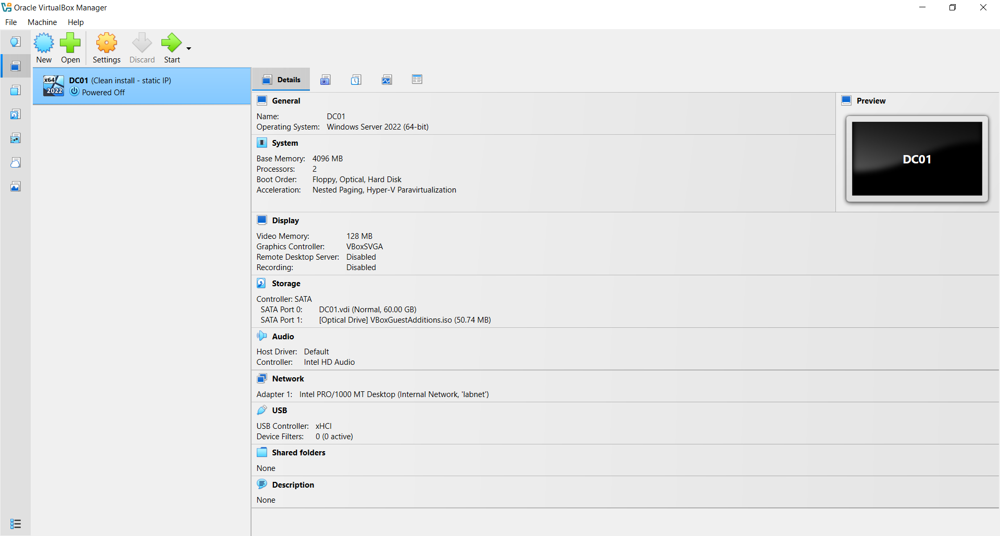
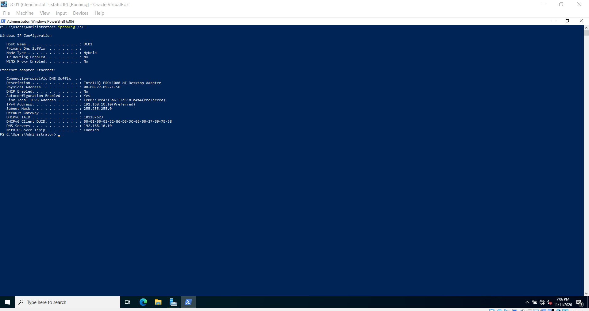

# Lab Setup: DC01, WIN11-01, UBU01

## Objective

Build a three-machine virtual lab in VirtualBox to practice help desk tasks: Active Directory, Windows troubleshooting, networking, and Linux basics.

## Environment

- Host PC: Intel Core i7-7700HQ CPU @ 2.80GHz, 48 GB RAM, Windows 10/11, VirtualBox 7.2.22
- Network: isolated internal network named `labnet` (192.168.10.0/24), no internet and no gateway

| VM | Role | Operating system | RAM | CPUs | Disk | IP address |
|----|------|------------------|-----|------|------|------------|
| DC01 | Domain controller (Week 2) | Windows Server 2022 Standard Evaluation | 4 GB | 2 | 60 GB | 192.168.10.10 |
| WIN11-01 | Domain-joined client | Windows 11 Enterprise Evaluation | 8 GB | 2 | 80 GB | 192.168.10.50 |
| UBU01 | Linux practice | Ubuntu 26.04.1 Desktop | 4 GB | 2 | 40 GB | 192.168.10.30 |

## Steps

### 1. DC01 (Windows Server 2022)

1. Created the VM in VirtualBox with 4 GB RAM, 2 CPUs, and a 60 GB disk, and skipped the unattended install.
2. Installed Windows Server 2022 Standard Evaluation (Desktop Experience).
3. Installed VirtualBox Guest Additions for screen resizing.
4. Renamed the computer to DC01.
5. Set the static IP 192.168.10.10 with DNS pointing to itself.
6. Enabled the ping firewall rule.
7. Took a snapshot named "Clean install - static IP".

### 2. WIN11-01 (Windows 11 Enterprise)

1. Created the VM with 8 GB RAM, 2 CPUs, and an 80 GB disk.
2. Enabled UEFI and TPM 2.0 in the VM's Motherboard settings, which Windows 11 requires.
3. Installed Windows 11 Enterprise Evaluation with a local account.
4. Renamed the PC to WIN11-01 and set the static IP 192.168.10.50 with DNS 192.168.10.10.
5. Enabled the ping firewall rule.
6. Took a snapshot.

### 3. UBU01 (Ubuntu)

1. Created the VM with 4 GB RAM, 2 CPUs, and a 40 GB disk.
2. Installed Ubuntu with the default ext4 file system and no disk encryption, because this is an isolated lab VM with no real data.
3. Temporarily switched the network adapter to NAT to download updates and install Guest Additions.
4. Switched the adapter back to `labnet` and set the static IP 192.168.10.30.
5. Took a snapshot.

### 4. Testing connectivity

From each VM, I pinged the other two to confirm the lab network works.

| From | To | Result |
|------|----|--------|
| DC01 | WIN11-01, UBU01 | 4 replies each, 0% loss |
| WIN11-01 | DC01, UBU01 | 4 replies each, 0% loss |
| UBU01 | DC01, WIN11-01 | 4 replies each, 0% loss |

## Troubleshooting

| Problem | Cause | Fix |
|---------|-------|-----|
| Ubuntu stopped at a red `vmwgfx` error during boot | The VMSVGA graphics controller does not work with Ubuntu's driver | Changed the controller to VBoxSVGA and left 3D acceleration off |
| Ubuntu had no internet (address 169.254.x.x) | The VM was set to get its address from NAT but the connection had not renewed | Set the connection to automatic addressing with `nmcli`, brought it up, and got 10.0.2.15 |
| Guest Additions installer said `bzip2 not found` | The required packages failed to install earlier because there was no internet | Installed `bzip2`, `tar`, `build-essential`, and `dkms` once the network worked, then re-ran the installer |
| "Network profile type" missing on Windows 11 | The lab network shows as "Unidentified network," which has no profile choice | Enabled the ICMP firewall rule with PowerShell instead |
| WIN11-01 had DC01's IP address | Entered 192.168.10.10 by mistake | Changed it to 192.168.10.50 |

## What I learned

- How to create and configure virtual machines, including UEFI and TPM requirements for Windows 11.
- How to diagnose a network problem by reading `ip a` and testing connectivity step by step.
- Why snapshots are useful: a safe restore point before making changes.