# Active Directory Lab

## Objective

For this lab I built a small Active Directory domain from scratch. I set up a Windows Server 2022 domain controller, organized it like a small company with departments, and joined a Windows 11 computer to the domain. My goal was to practice the account and workstation setup that a Tier 1 help desk technician sees on the job. This README explains each step the way I did it, so I can repeat it later.

## Environment

Both machines run as virtual machines in VirtualBox 7.2.22 on a private internal network called `labnet` (192.168.10.0/24). The network has no internet access, so the lab stays separate from my home network. The domain name is `lab.local`.

| Machine | Role | Operating system | IP address |
|---------|------|------------------|------------|
| DC01 | Domain controller and DNS server | Windows Server 2022 Standard Evaluation | 192.168.10.10 |
| WIN11-01 | Domain-joined client | Windows 11 Enterprise Evaluation | 192.168.10.50 |

## Steps

### 1. Install the server roles on DC01

Before changing anything, I shut down DC01 and took a VirtualBox snapshot called "Before AD DS install" so I could go back if something broke. Then I installed the roles:

1. On DC01, in Server Manager, I clicked **Manage > Add Roles and Features**.
2. I clicked **Next** until I reached **Server Roles**.
3. I ticked **Active Directory Domain Services** and clicked **Add Features** when the box popped up.
4. I did the same for **DNS Server** and **DHCP Server**.
5. I clicked **Next** through the remaining screens and then **Install**.
6. When it said "Installation succeeded," I clicked **Close**.

The wizard also told me that more steps were needed to make the machine a domain controller, which is what I did next. DHCP says it needs configuration too. I only installed that role for now and will set it up in a later lab.

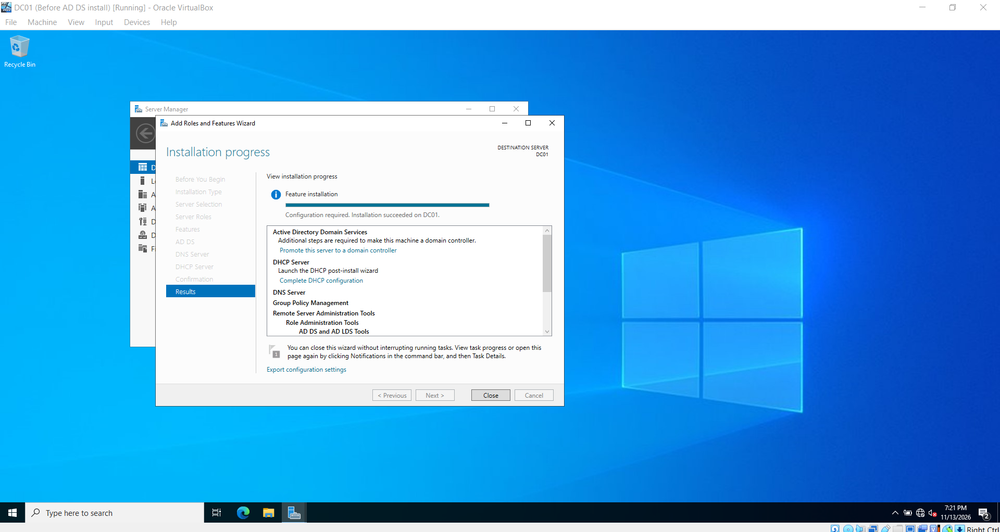

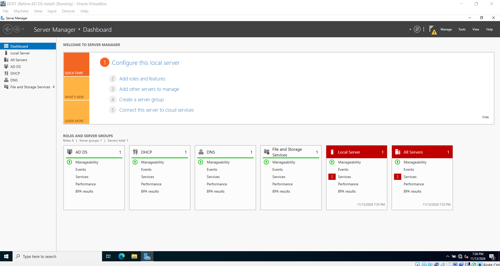

### 2. Promote DC01 to a domain controller

1. In Server Manager I clicked the yellow warning flag at the top and chose **Promote this server to a domain controller**.
2. I selected **Add a new forest** and typed `lab.local` as the root domain name.
3. I left the functional levels at their defaults and set a Directory Services Restore Mode (DSRM) password. I keep this password private.
4. On the DNS options page I got a warning about DNS delegation. This is normal for a first domain, so I clicked **Next**.
5. I left the NetBIOS name as `LAB` and the folder paths as the defaults, then clicked **Install**.
6. DC01 restarted by itself. After it came back, I signed in as `LAB\Administrator`.

To check that it worked, I opened Server Manager's **Local Server** page. It shows the computer name DC01, the domain `lab.local`, and the IP address 192.168.10.10. After that I shut down DC01 and took a snapshot called "Domain built."

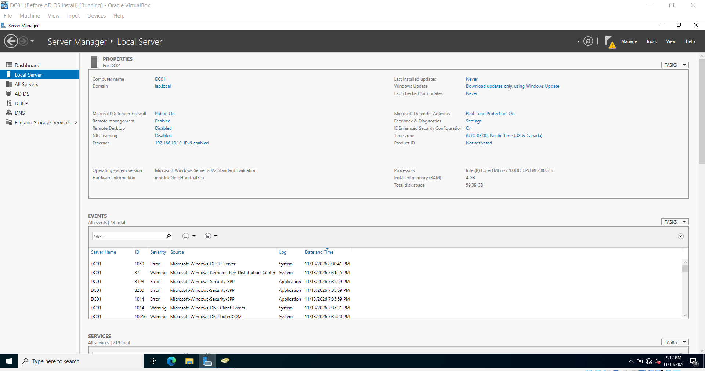

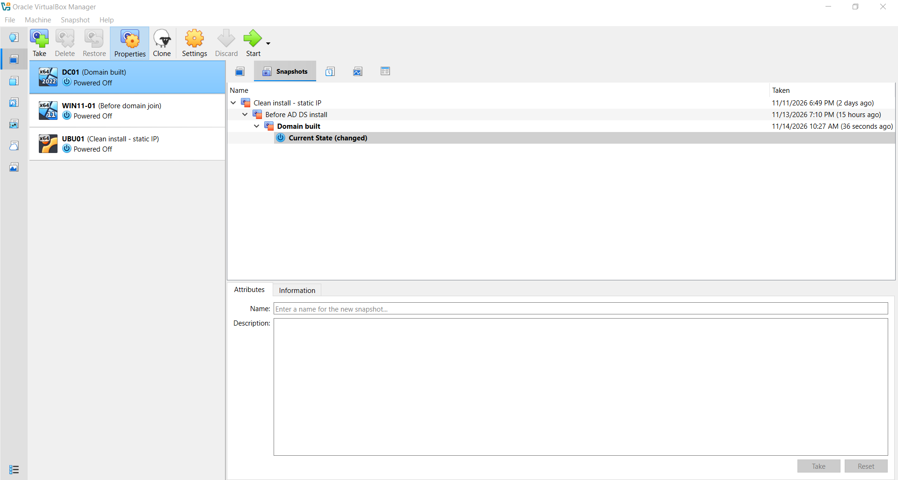

### 3. Create the OUs, users, and groups

I did all of this in **Active Directory Users and Computers**, which I opened from Server Manager under **Tools**.

**Organizational Units (OUs).** I right-clicked `lab.local`, chose **New > Organizational Unit**, and created five OUs: Sales, HR, IT, Disabled Users, and Workstations. The OUs are like departments in a company. The other folders in the tree, such as Computers and Users, are built-in containers that AD makes by itself.

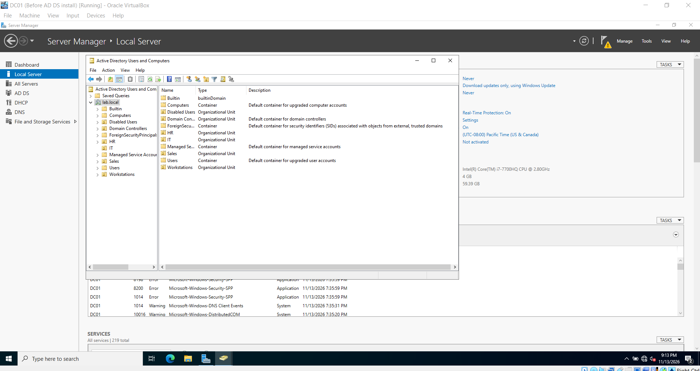

**Users.** To make a user, I right-clicked an OU and chose **New > User**. I typed a first name, last name, and user logon name, then set a password. I ticked "User must change password at next logon." I used made-up names and put 10 users in the OU for their department:

- **Sales:** Eric Cline, John Smith, Lisa Smith, Patty Cline
- **HR:** Al Lee, Jimmy Lee, Kane Everett, Milly Everett
- **IT:** Byron Jones, Sheena Jones

**Groups.** To make a group, I right-clicked a department OU and chose **New > Group**. I used the scope **Global** and the type **Security**, and created `Sales-Users`, `HR-Users`, and `IT-Helpdesk`.

**Adding members.** I double-clicked each group (groups open in a pop-up window, unlike OUs), opened the **Members** tab, clicked **Add**, typed the user names separated by semicolons, clicked **Check Names**, and then **OK**. I clicked **OK** again on the group window so the change would save. Every user is now in the group for their department. The screenshot also shows which OU each user is stored in.

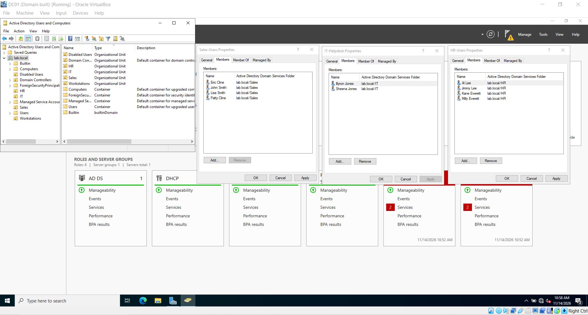

### 4. Check the network and DNS on WIN11-01

Before joining the domain, I checked WIN11-01 from PowerShell.

1. `ipconfig /all` shows the static IP 192.168.10.50, the mask 255.255.255.0, and DNS server 192.168.10.10, which is DC01. The DNS setting matters because a computer has to use the domain controller for DNS to find the domain.
2. `ping 192.168.10.10` got 4 replies with 0% loss.
3. `nslookup lab.local` returned 192.168.10.10 and showed the server name `DC01.lab.local`.

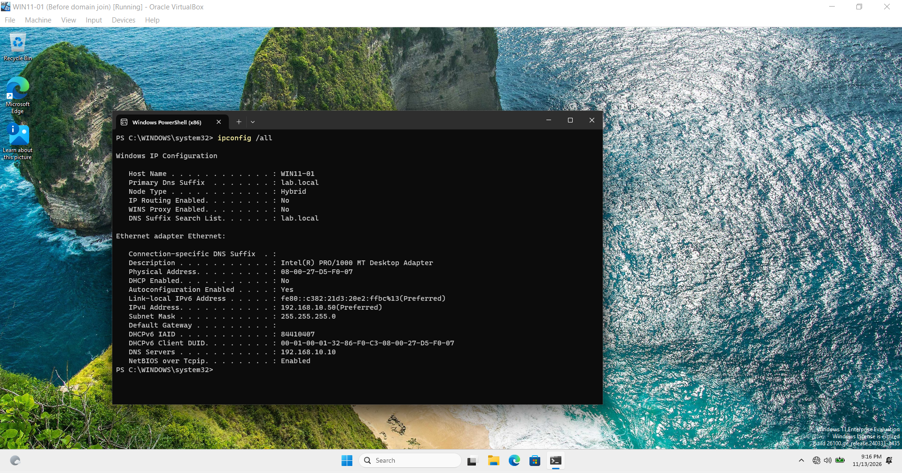

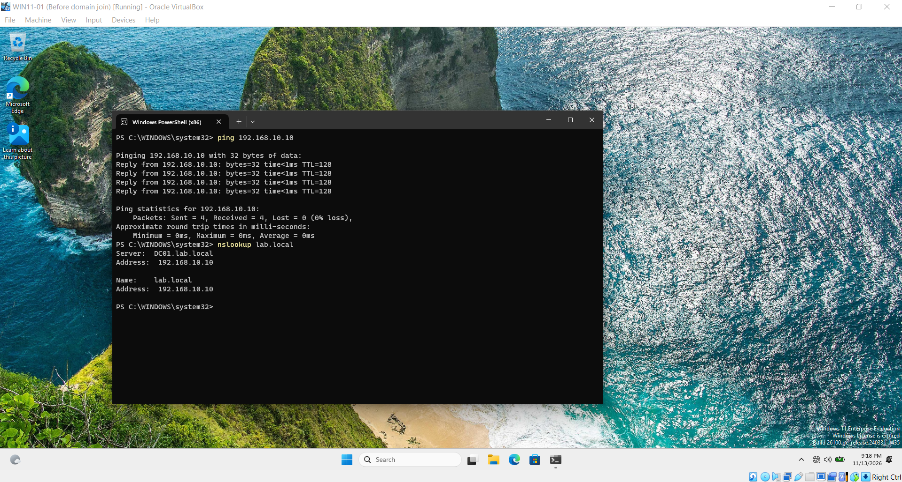

The first time I ran `nslookup`, it printed `Server: UnKnown` and a "DNS request timed out" message, even though it still found the domain. This happened because DC01 had no **reverse lookup zone**, so it could not turn its own IP address back into a name. I fixed it on DC01:

1. In Server Manager I clicked **Tools > DNS**.
2. I expanded **DC01**, right-clicked **Reverse Lookup Zones**, and chose **New Zone**.
3. I picked **Primary zone** and kept **Store the zone in Active Directory** ticked.
4. For the replication scope I chose **To all DNS servers running on domain controllers in this domain**.
5. I picked **IPv4 Reverse Lookup Zone** and typed the network ID `192.168.10`.
6. I accepted the defaults on the remaining pages and clicked **Finish**.
7. In an Administrator PowerShell window on DC01, I ran `ipconfig /registerdns` and waited a minute.

After that, `nslookup lab.local` on WIN11-01 showed `DC01.lab.local` instead of UnKnown.

### 5. Join WIN11-01 to the domain

I shut down WIN11-01 and took a snapshot called "Before domain join." Then:

1. On WIN11-01, I pressed **Windows + R**, typed `sysdm.cpl`, and pressed Enter.
2. On the **Computer Name** tab, I clicked **Change**.
3. I chose **Domain** and typed `lab.local`, then clicked **OK**.
4. When Windows asked for credentials, I typed `LAB\administrator` (with a backslash) and the domain Administrator password.
5. A message welcomed me to the domain. I clicked **OK** and restarted.

After the restart, System Properties showed the full computer name `WIN11-01.lab.local` and the domain `lab.local`. I took a snapshot called "Domain joined."

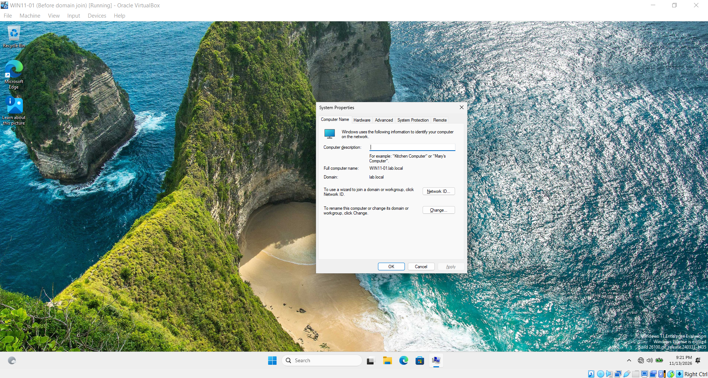

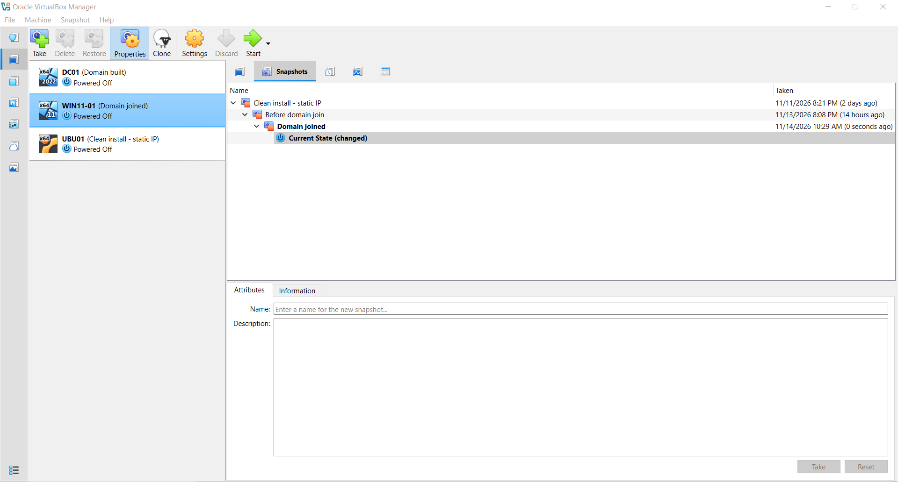

### 6. Move the computer into the Workstations OU

A computer that joins the domain goes into the default Computers container. On DC01 I opened that container, found WIN11-01, right-clicked it, chose **Move**, picked the `Workstations` OU, and clicked **OK**. This keeps computers separate from user accounts and is easier to manage.

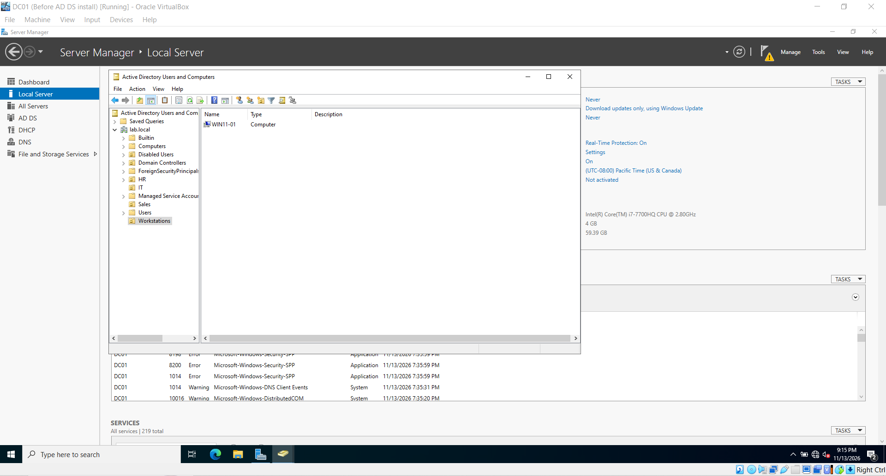

### 7. Sign in with a domain account

On the WIN11-01 sign-in screen I clicked **Other user** and signed in with a domain account from the IT OU. In PowerShell, `whoami` printed `lab\bjones` and `hostname` printed `WIN11-01`. This shows that the account lives on the domain controller and that I can sign in to the workstation with it.

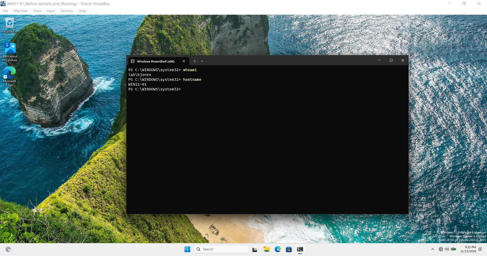

### 8. Reset the Windows evaluation timer on WIN11-01

WIN11-01 showed a "Windows License is expired" message in the bottom right of the desktop, because the Windows 11 Enterprise evaluation timer ran out. An expired evaluation can start shutting a VM down by itself, which would interrupt my lab. I reset the timer like this:

1. I right-clicked **Start** and chose **Terminal (Admin)**, then clicked **Yes**. It has to run as Administrator.
2. I ran `slmgr /dlv` to see the license status and the time remaining.
3. I ran `slmgr /rearm`, which resets the evaluation timer.
4. I restarted WIN11-01.

Evaluation copies only allow a limited number of rearms, so I only run it when the license has actually expired.

## Troubleshooting

| Problem | What caused it | How I fixed it |
|---------|----------------|----------------|
| The domain join failed with "The specified username is invalid" | I typed `LAB/administrator` with a forward slash | I typed it with a backslash instead: `LAB\administrator` |
| Creating an OU called "Computers" gave an error saying the name was already in use | AD already has a built-in Computers container with that name | I named my OU `Workstations` instead |
| `nslookup lab.local` printed `Server: UnKnown` and a timeout message | DC01 had no reverse lookup zone to turn its IP address back into a name | I added a reverse lookup zone for 192.168.10.0/24 and ran `ipconfig /registerdns`, and now `nslookup` shows `DC01.lab.local` |
| `slmgr /rearm` showed "Error 0xC004F025 Access denied: the requested action requires elevated privileges" | My PowerShell window was not running as Administrator | I opened PowerShell with **Run as administrator** and ran the command again |
| WIN11-01 showed "Windows License is expired" | The 90-day evaluation timer ran out | I ran `slmgr /rearm` in an Administrator window and restarted |

## What I learned

- The domain controller and DNS depend on each other. WIN11-01 could only find and join `lab.local` after I pointed its DNS to DC01.
- Snapshots are really useful. I took them before big changes like installing roles and joining the domain, so I always had a way back.
- Small mistakes, like a slash going the wrong way or running a command without admin rights, can cause errors that look more serious than they are. Reading the error message carefully helped me find each problem.

## Next steps

- Configure DHCP on DC01 so WIN11-01 gets its address automatically.
- Practice common help desk tasks such as password resets, unlocking accounts, onboarding and offboarding users, shared folders with permissions, and Group Policy.