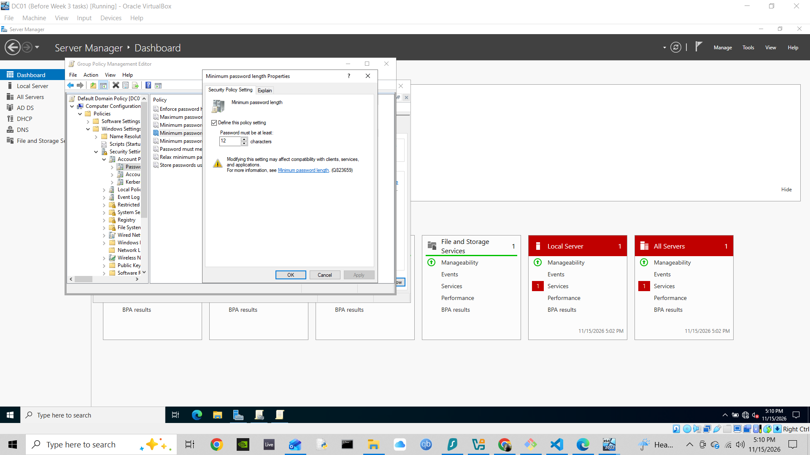
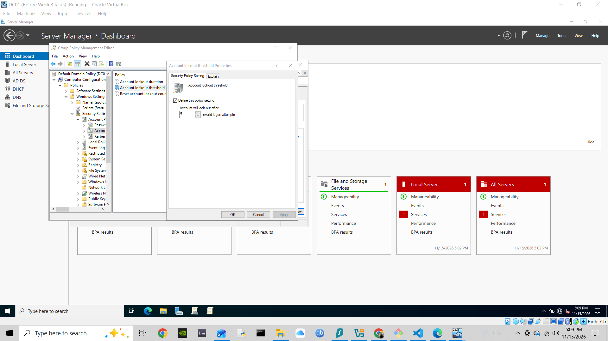
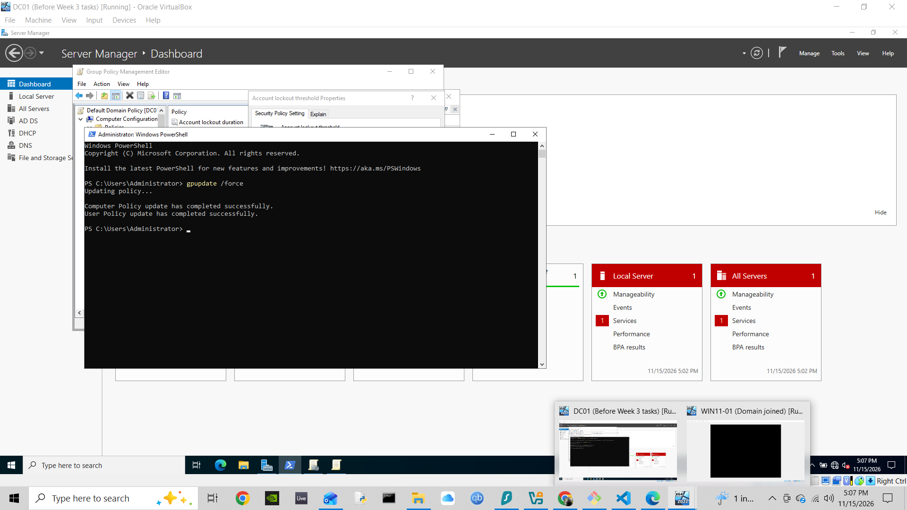
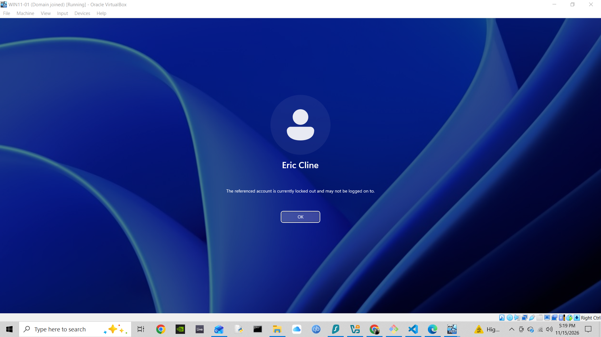
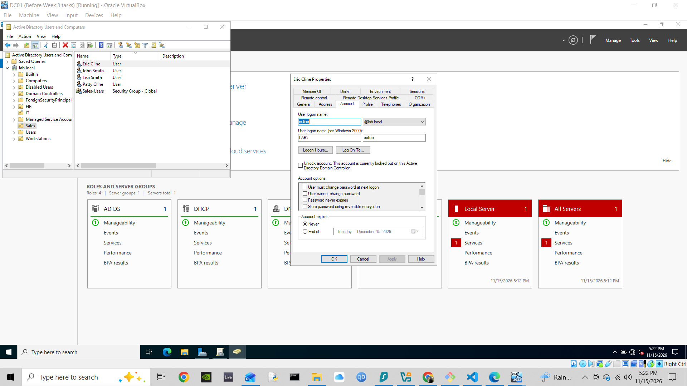
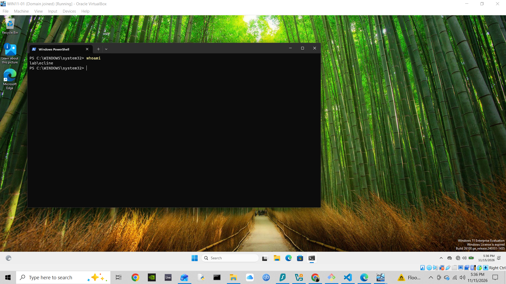

# Password Reset and Account Unlock

## Objective

I locked out a Sales user after too many wrong passwords, then unlocked the account and reset the password in Active Directory Users and Computers. Help desk techs do this every day, so I wanted to practice the whole process.

## Environment

- DC01: Windows Server 2022 Standard Evaluation, domain controller for `lab.local`
- WIN11-01: Windows 11 Enterprise Evaluation, joined to `lab.local`
- Test user: Eric Cline, in the Sales OU
- Tools: Group Policy Management Editor, Active Directory Users and Computers, PowerShell

## Steps

**Part 1: Turn on account lockout.** A new domain starts with lockout turned off, so an account never locks no matter how many wrong passwords someone types. I had to change that first.

1. On DC01, I opened **Tools > Group Policy Management**, expanded **lab.local**, right-clicked **Default Domain Policy**, and chose **Edit**.
2. I went to **Computer Configuration > Policies > Windows Settings > Security Settings > Account Policies > Password Policy**. I double-clicked **Minimum password length**, ticked **Define this policy setting**, and set it to `12`.

   

3. I opened **Account Lockout Policy**, double-clicked **Account lockout threshold**, and set it to `5` invalid logon attempts. The lockout duration and reset counter values were filled in for me, and I accepted them.

   

4. I closed the editor and ran `gpupdate /force` in an Administrator PowerShell window. It said both the computer and user policy updates completed successfully.

   

**Part 2: Lock out the account.** On WIN11-01 I signed out, chose **Other user**, and signed in as Eric Cline with a wrong password. I repeated this until I hit the fifth wrong attempt. The sign-in screen then showed that the account was locked.

**Part 3: Unlock the account.** On DC01 I opened **Active Directory Users and Computers**, expanded **lab.local > Sales**, and double-clicked **Eric Cline**. On the **Account** tab, the **Unlock account** box was ticked, which showed that the account was locked. I unticked it and clicked **OK**.

**Part 4: Reset the password.** I right-clicked Eric Cline, chose **Reset Password**, typed a new lab-only password that is at least 12 characters, and ticked **User must change password at next logon**. I clicked **OK** to confirm the reset.

**Part 5: Confirm the new password works.** On WIN11-01 I signed in as Eric Cline with the new password. I opened PowerShell and ran `whoami`, which printed `lab\ecline`. This shows that the account is unlocked and the sign-in works.

## Troubleshooting

| Problem | What caused it | How I fixed it |
|---------|----------------|----------------|
| Wrong passwords never locked the account | A new domain has account lockout turned off by default | I set the Account lockout threshold to 5 in the Default Domain Policy and ran `gpupdate /force` on DC01 |

## What I learned

- A locked account shows the **Unlock account** checkbox on its Account tab in Active Directory Users and Computers.
- Unlocking an account and resetting its password are two separate tasks, and I did both.
- Password and lockout settings live in Group Policy, so a policy change only applies after `gpupdate /force` or the next sign-in.
