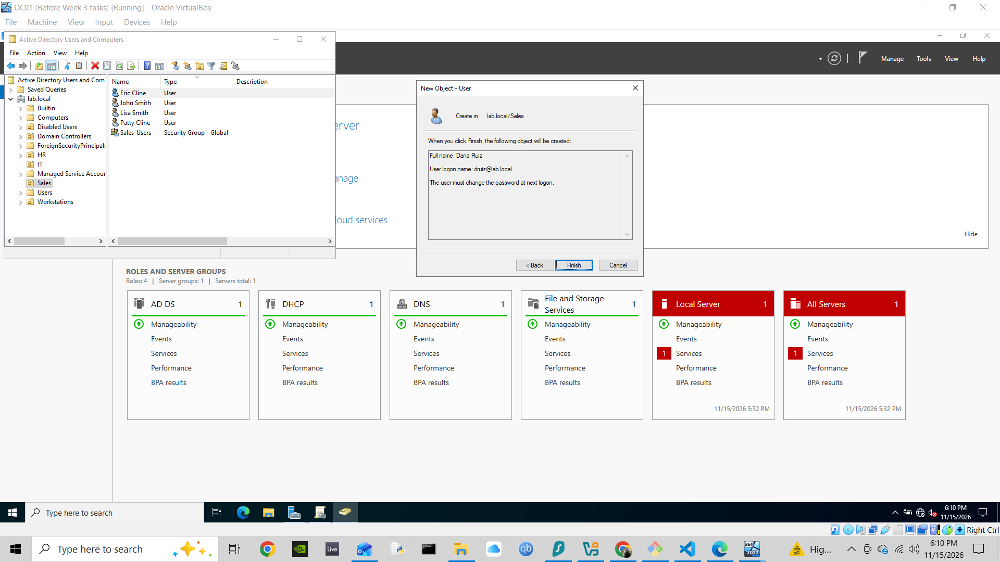
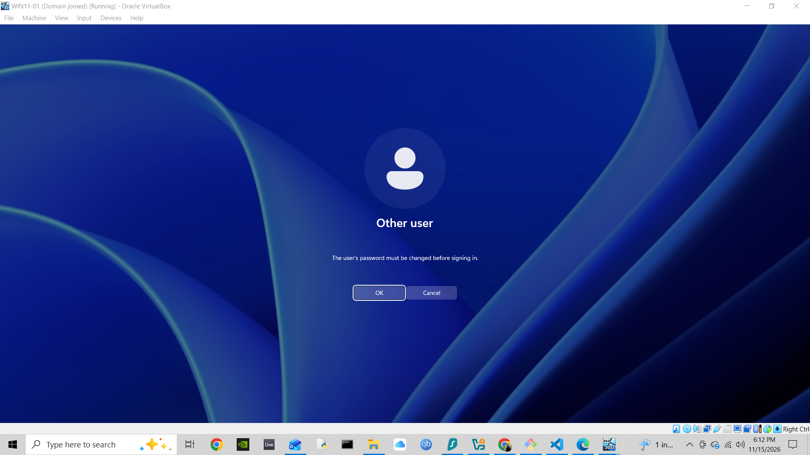
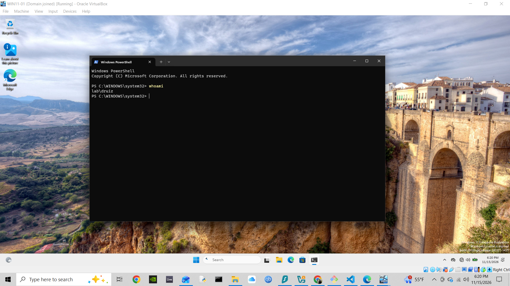

# New Hire Account Setup

## Objective

I created a new user account for a new Sales employee in Active Directory, added the account to the correct group, and confirmed the new user could sign in to a workstation. This is one of the most common tickets a Tier 1 help desk tech handles.

## Environment

- DC01: Windows Server 2022 Standard Evaluation, domain controller for `lab.local`
- WIN11-01: Windows 11 Enterprise Evaluation, joined to `lab.local`
- New user: Dana Ruiz (logon name `druiz`), in the Sales OU
- Tools: Active Directory Users and Computers, PowerShell

## Steps

**Part 1: Create the user.** On DC01 I opened **Active Directory Users and Computers**, right-clicked the **Sales** OU, and chose **New > User**. I typed `Dana` as the first name, `Ruiz` as the last name, and `druiz` as the user logon name, then clicked **Next**. I set a temporary lab password, ticked **User must change password at next logon**, and clicked **Finish**.

**Part 2: Add the user to the group.** I double-clicked the **Sales-Users** group, opened the **Members** tab, and clicked **Add**. I typed `Dana Ruiz`, clicked **Check Names**, then **OK**. I clicked **Apply** and **OK** to save. The Members list now shows Dana Ruiz with the Sales OU path.

**Part 3: Sign in for the first time.** On WIN11-01 I chose **Other user** and signed in as `lab\druiz` with the temporary password. Windows stopped and asked me to change the password before signing in. I clicked **OK** and set a new password that meets the 12-character minimum, then signed in.

**Part 4: Confirm the account.** I opened PowerShell and ran `whoami`, which printed `lab\druiz`. This shows the account signed in with the domain name.

**The new hire checklist.** Here is the checklist I would follow for every new hire:

- Create the account in the correct department OU.
- Set a temporary password and require a change at first sign-in.
- Add the user to the matching department group.
- Confirm the user can sign in to a workstation and change the password.
- Record the account name, start date, and manager in the ticket.

## Troubleshooting

| Problem | What caused it | How I fixed it |
|---------|----------------|----------------|
| Windows said "The user's password must be changed before signing in" | The account was created with **User must change password at next logon** ticked, so the temporary password cannot be used for a normal sign-in | I clicked **OK**, set a new password that met the policy, and signed in again |

## What I learned

- A new account needs two things before it is useful: the right OU for the department and membership in the matching group.
- The first sign-in is where a new user changes their temporary password, so the help desk should warn new hires about it.
- Checking `whoami` after sign-in is a quick way to confirm the account and domain are correct.