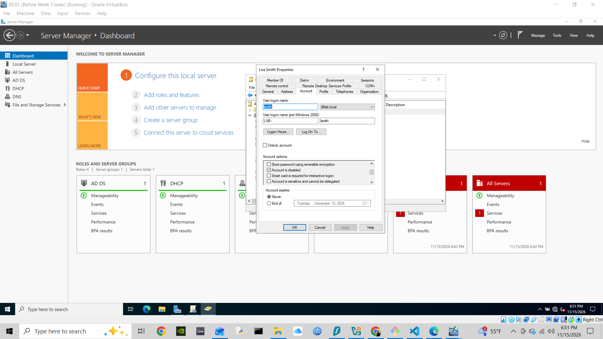
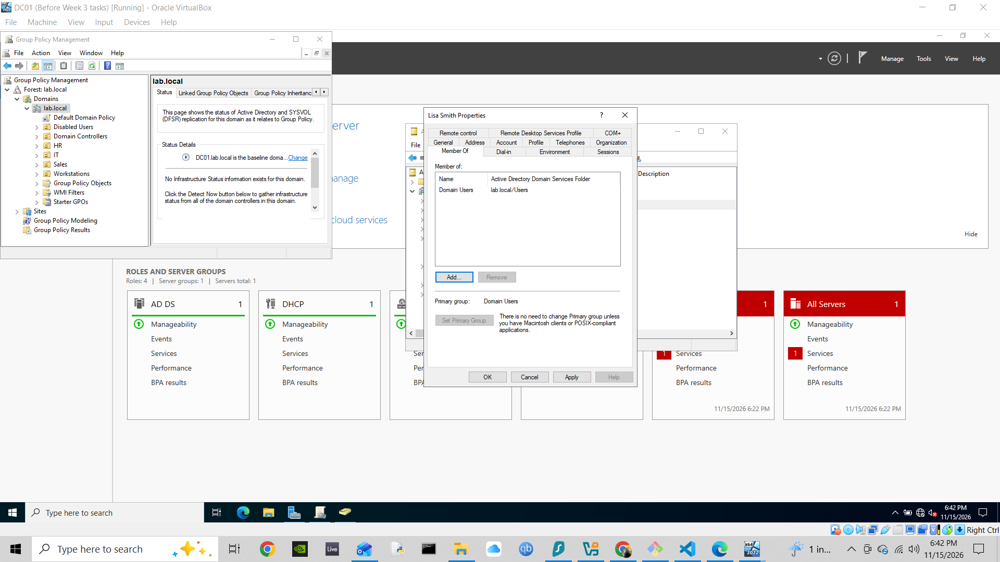
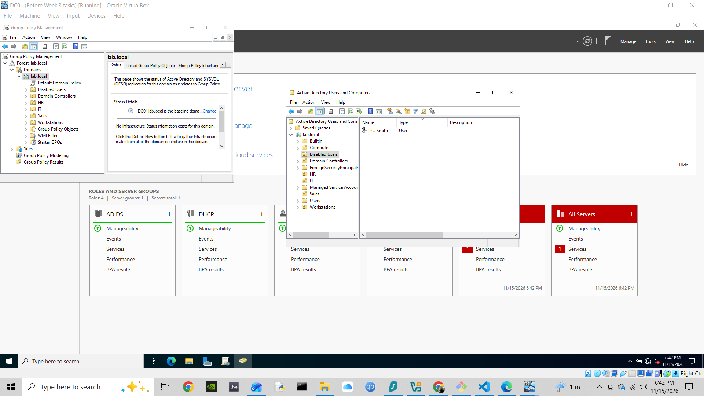
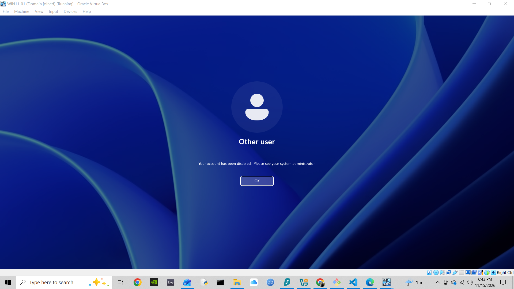

# Disable a Departing Employee

## Objective

I disabled the account of a Sales employee who had left the company, removed her group memberships, moved the account to the Disabled Users OU, and confirmed she could no longer sign in. Offboarding is a common help desk ticket, and blocking access quickly is important for security.

## Environment

- DC01: Windows Server 2022 Standard Evaluation, domain controller for `lab.local`
- WIN11-01: Windows 11 Enterprise Evaluation, joined to `lab.local`
- Departing user: Lisa Smith (logon name `lsmith`), in the Sales OU
- Tools: Active Directory Users and Computers, PowerShell

## Steps

**Part 1: Disable the account.** On DC01 I opened **Active Directory Users and Computers**, expanded **lab.local > Sales**, and right-clicked **Lisa Smith**. I chose **Disable Account** and clicked **OK** on the confirmation. In ADUC, a disabled account shows a small down arrow on its user icon. Lisa Smith is still in the Sales OU here, and the arrow is visible.

**Part 2: Confirm the account is disabled.** I double-clicked Lisa Smith and opened the **Account** tab. In the **Account options** list, the **Account is disabled** box is ticked. I scrolled the list to find it, because it sits below the options shown at the top.

I also right-clicked Lisa Smith again, and the menu offered **Enable Account**, which confirmed the status.

**Part 3: Remove group memberships.** I opened the **Member Of** tab. I selected **Sales-Users** and clicked **Remove**, then **OK**. Only **Domain Users** was left, which is the default group every account has.

I removed the group memberships so that if the account is ever turned back on, it doesn't keep the Sales access it had before.

**Part 4: Move the account.** I right-clicked Lisa Smith, chose **Move**, selected **Disabled Users**, and clicked **OK**. The Disabled Users OU now shows her account.

**Part 5: Confirm sign-in is blocked.** On WIN11-01 I chose **Other user** and tried to sign in as `lab\lsmith` with her old password. Windows showed that the account has been disabled and asked me to see the system administrator.

## Troubleshooting

I did not run into any problems with this task. Each step worked the first time.

## What I learned

- Disabling an account stops access right away, so I do this first in offboarding.
- A disabled account shows a down arrow in ADUC, and the Account tab confirms it with the **Account is disabled** box.
- Removing group memberships keeps old permissions from coming back if the account is re-enabled.
- Moving the account to Disabled Users makes disabled accounts easy to find and audit.