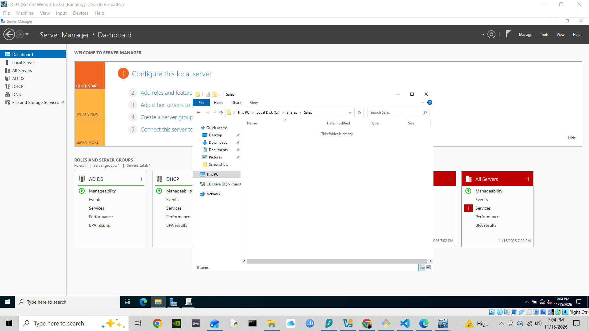
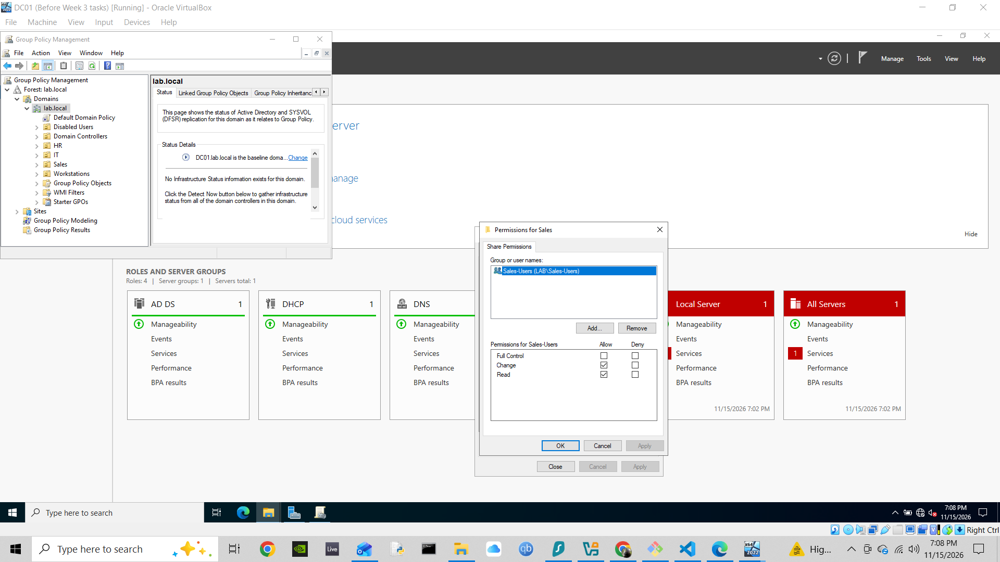
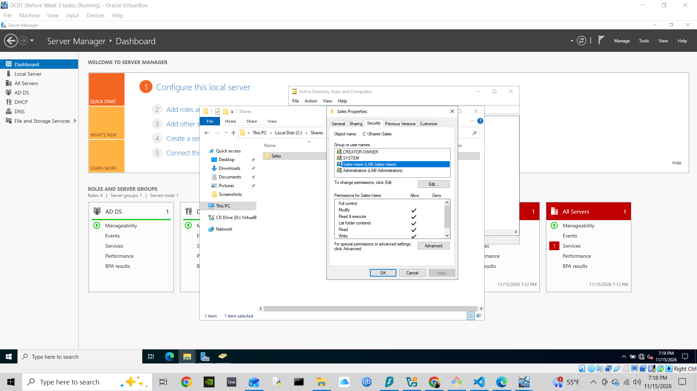
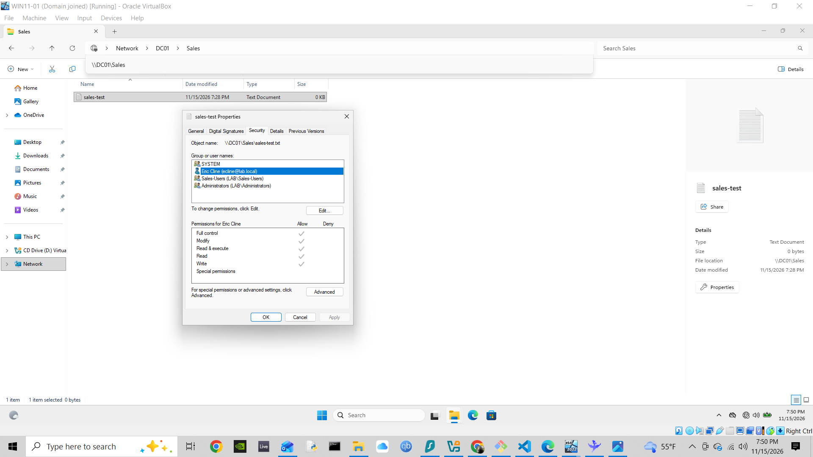
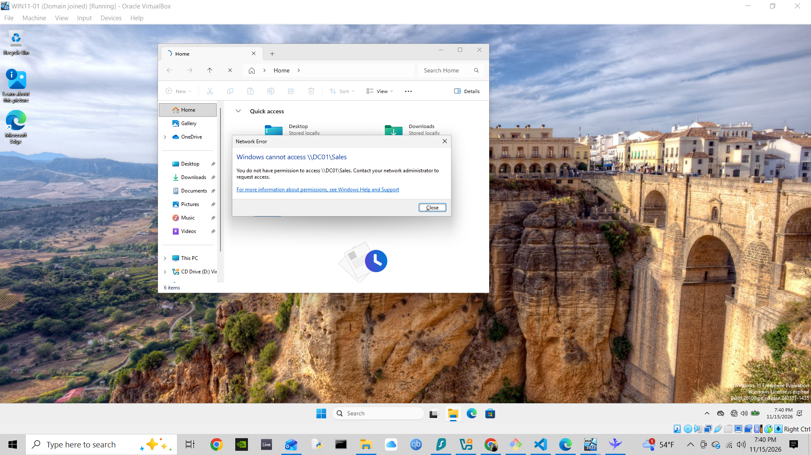

# Shared Folder with Permissions

## Objective

I created a shared folder on DC01 for the Sales department, set the permissions so only the Sales-Users group could open it, and tested the result from a Sales user and an HR user. Shared folders and permissions are one of the most common requests a Tier 1 help desk tech gets, such as "I can't open the department folder."

## Environment

- DC01: Windows Server 2022 Standard Evaluation, domain controller for `lab.local`
- WIN11-01: Windows 11 Enterprise Evaluation, joined to `lab.local`
- Folder: `C:\Shares\Sales`, shared as `\\DC01\Sales`
- Groups: Sales-Users (should have access), HR-Users (should be denied)
- Tools: File Explorer, Advanced Sharing, NTFS permissions, PowerShell

## Steps

**Part 1: Create the folder.** On DC01 I opened File Explorer, went to `C:\`, and created a folder called `Shares`. Inside it I created a folder called `Sales`, so the full path is `C:\Shares\Sales`.

**Part 2: Set the share permissions.** I right-clicked **Sales**, chose **Properties**, and opened the **Sharing** tab. I clicked **Advanced Sharing**, ticked **Share this folder**, and kept the share name as `Sales`. I clicked **Permissions** and removed **Everyone**. Then I added **Sales-Users** and ticked **Change** for that group, so members could read and write files. I clicked **OK** on each window.

**Part 3: Set the NTFS permissions.** Share permissions control access over the network, and NTFS permissions control access on the disk. I needed both. On the **Security** tab I clicked **Advanced** and turned off inheritance, so the folder would not keep access from `C:\`. I removed the **Users** group, which was inherited from the parent folder. I kept **SYSTEM** and **Administrators**, then added **Sales-Users** with **Modify** allowed.

The first time, I looked for Modify in the Advanced permission entry window and couldn't find it there. The fix was to add the group from the main **Security** tab with **Edit**, then tick **Modify** under **Allow**.

**Part 4: Test as a Sales user.** On WIN11-01 I signed in as a Sales user, Eric Cline, and opened `\\DC01\Sales` in File Explorer. The folder opened, and I created a new file called `sales-test`, which saved without error.

**Part 5: Test as an HR user.** I signed out and signed in as an HR user. When I tried to open `\\DC01\Sales`, Windows showed a Network Error saying the user did not have permission to access the folder. This is the result I wanted, because HR is not in Sales-Users.

## Troubleshooting

| Problem | What caused it | How I fixed it |
|---------|----------------|----------------|
| There was no Modify option in the Advanced permission entry window when I added Sales-Users | I was looking in the Advanced window instead of the main Security tab | I clicked **Edit** on the Security tab, added Sales-Users there, and ticked **Modify** under **Allow** |

## What I learned

- Share permissions and NTFS permissions both apply, and Windows uses the more restrictive of the two.
- Turning off inheritance and removing the broad **Users** group keeps a department folder closed to other staff.
- Testing with one user who should have access and one who should not proves the permissions work.