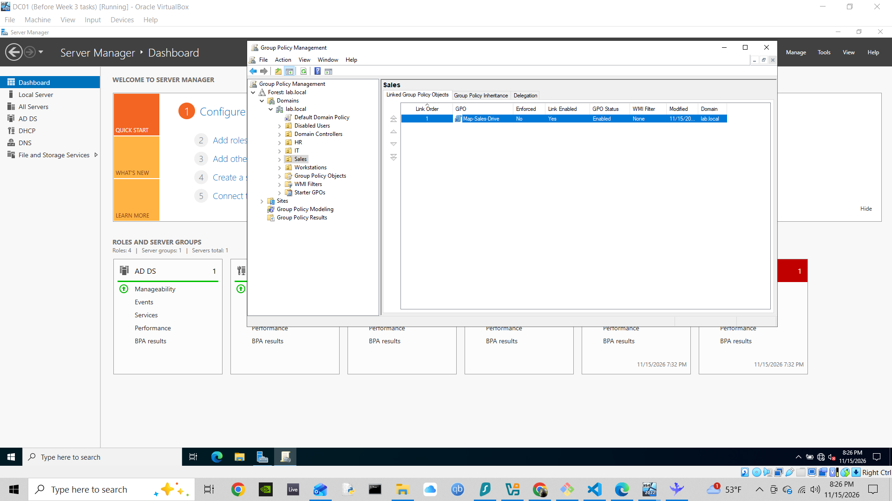
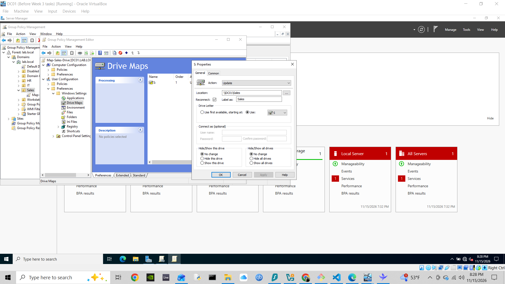
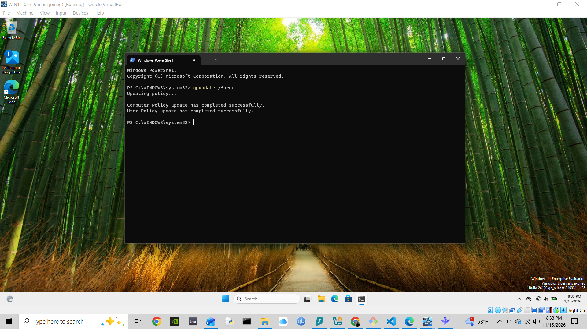
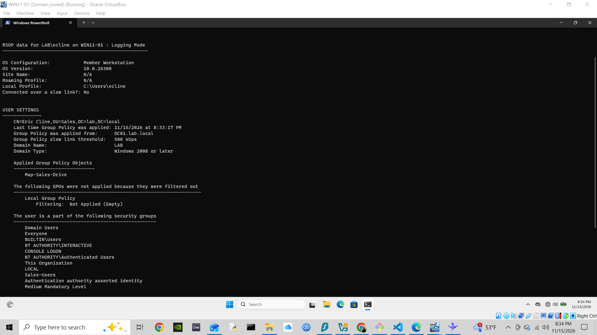
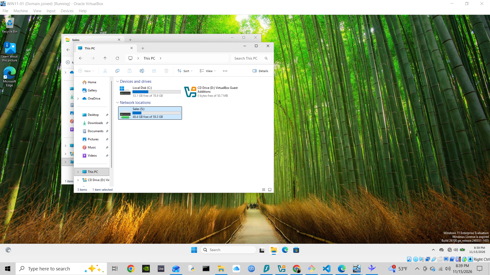

# Map a Network Drive with Group Policy

## Objective

I created a Group Policy Object (GPO) that maps the Sales file share as drive S: for every user in the Sales OU. Mapped drives are a common ticket, and using Group Policy means users don't have to map drives by hand.

## Environment

- DC01: Windows Server 2022 Standard Evaluation, domain controller for `lab.local`
- WIN11-01: Windows 11 Enterprise Evaluation, joined to `lab.local`
- Share: `\\DC01\Sales`
- Test user: Eric Cline, in the Sales OU
- Tools: Group Policy Management, Group Policy Management Editor, PowerShell

## Steps

**Part 1: Create and link the GPO.** On DC01 I opened **Tools > Group Policy Management**, expanded **Forest > Domains > lab.local**, and right-clicked **Sales**. I chose **Create a GPO in this domain, and Link it here**, named it `Map-Sales-Drive`, and clicked **OK**. The GPO now appears under the Sales OU with Link Enabled set to **Yes**.

**Part 2: Add the drive map.** I right-clicked **Map-Sales-Drive** and chose **Edit**. Under **User Configuration > Preferences > Windows Settings**, I clicked **Drive Maps**, then right-clicked the empty area and chose **New > Mapped Drive**. I set these values:

- Action: **Update**
- Location: `\\DC01\Sales`
- Reconnect: ticked
- Label as: `Sales`
- Drive Letter: **Use**, set to `S`

I clicked **Apply** and **OK**. I used **User Configuration** because drive maps apply to the signed-in user, not to the computer.

**Part 3: Apply the policy and check it.** At first, the policy did not apply to Eric Cline's session. I opened PowerShell on WIN11-01 and ran `gpupdate /force`, which updated both the computer and user policy.

Then I ran `gpresult /r` as Eric Cline. Under **Applied Group Policy Objects**, `Map-Sales-Drive` is listed, and the last time policy was applied matches the `gpupdate` run.

**Part 4: Check the drive.** I opened File Explorer and went to **This PC**. Under **Network locations**, **Sales (S:)** appeared with 48.4 GB free of 59.3 GB, which shows the drive is connected to the share.

## Troubleshooting

| Problem | What caused it | How I fixed it |
|---------|----------------|----------------|
| `gpresult /r` showed **N/A** under Applied Group Policy Objects, so Map-Sales-Drive did not apply | Eric Cline's session had last applied policy before I finished the drive map settings | I ran `gpupdate /force` in PowerShell, then ran `gpresult /r` again, and Map-Sales-Drive was listed as applied |

## What I learned

- Link a GPO to the OU that holds the users it should affect.
- Drive maps set under **User Configuration** apply to the user at sign-in.
- `gpresult /r` shows whether a GPO actually applied, so it's the first check when a policy seems to be missing.
- `gpupdate /force` applies policy changes without waiting for the next refresh, which is useful right after editing a GPO.