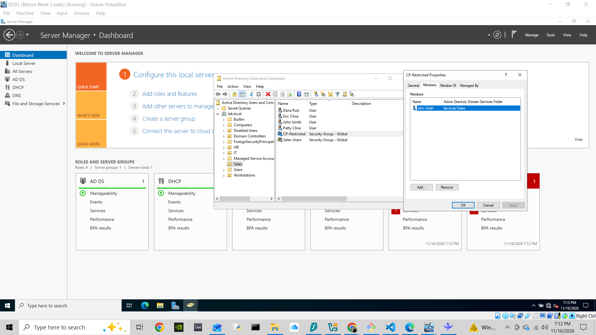
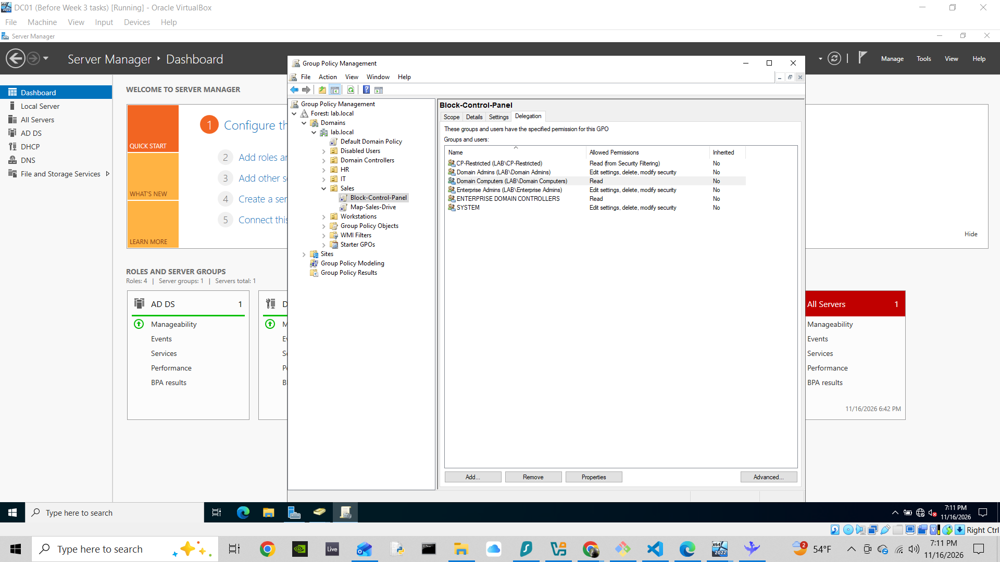
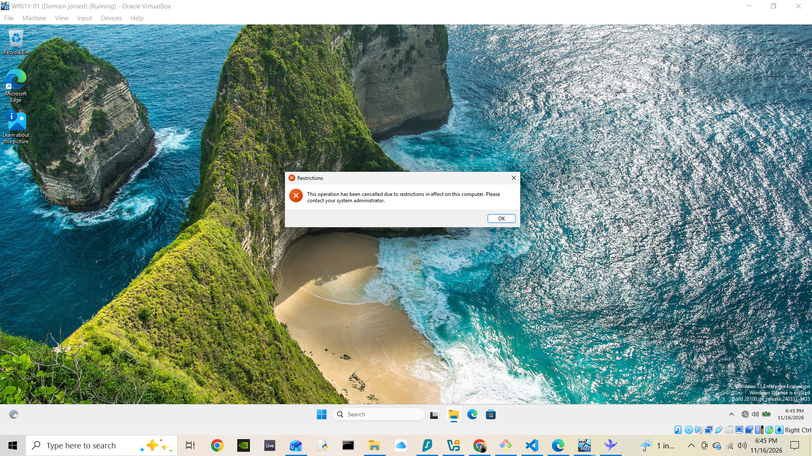

# Block Control Panel with a Group Policy

## Objective

I used Group Policy to block Control Panel for one test group, CP-Restricted, while the rest of the Sales OU kept normal access. This is a common way to lock down a shared or kiosk-style computer without changing the whole department.

## Environment

- DC01: Windows Server 2022 Standard Evaluation, domain controller for `lab.local`
- WIN11-01: Windows 11 Enterprise Evaluation, joined to `lab.local`
- Test group: CP-Restricted, with John Smith as the only member
- Comparison user: Eric Cline, who is in Sales-Users but not in CP-Restricted
- Tools: Active Directory Users and Computers, Group Policy Management, PowerShell

## Steps

**Part 1: Create the test group.**

1. On DC01, open **Active Directory Users and Computers**.
2. Right-click **Sales**, choose **New > Group**.
3. Name it `CP-Restricted`, set the scope to **Global** and the type to **Security**, and click **OK**.
4. Double-click **CP-Restricted**, open the **Members** tab, click **Add**, type `John Smith`, click **Check Names**, then **OK**.

**Part 2: Create the GPO and link it to the Sales OU.**

1. Open **Group Policy Management**.
2. Right-click **Sales** and choose **Create a GPO in this domain**.
3. Name it `Block-Control-Panel` and click **OK**.

**Part 3: Set the policy.**

1. Right-click **Block-Control-Panel** and choose **Edit**.
2. Go to **User Configuration > Policies > Administrative Templates > Control Panel**.
3. Double-click **Prohibit access to Control Panel and PC settings**, choose **Enabled**, and click **OK**.

**Part 4: Limit the GPO to the test group (security filtering).**

1. In Group Policy Management, click **Block-Control-Panel**.
2. Open the **Scope** tab and find **Security Filtering**.
3. Select **Authenticated Users** and click **Remove**.
4. Click **Add**, type `CP-Restricted`, and click **OK**.

**Part 5: Let computers read the GPO.** This is the step I first missed.

1. Stay on **Block-Control-Panel** and open the **Delegation** tab.
2. Click **Add**, type `Domain Computers`, and click **OK**.
3. Leave the permission as **Read**. Do not give it **Apply group policy**.
4. Click **OK**.

A computer has to download a GPO before it can apply it to a user. When Authenticated Users is removed, the computer account loses permission to read the GPO, so the policy never reaches the client. Adding Domain Computers with Read restores that.

**Part 6: Verify on DC01.**

1. Click **Block-Control-Panel** and open the **Settings** tab.
2. Scroll to **User Configuration (Enabled)**. Confirm that **Prohibit access to Control Panel and PC settings** shows **Enabled**.
3. Confirm that Security Filtering lists only **CP-Restricted**, and that the Delegation tab lists **Domain Computers** with Read.

**Part 7: Test on WIN11-01.**

1. Open PowerShell and run `gpupdate /force`.
2. Sign out of `lab\jsmith` and sign back in.
3. Open **Control Panel** (type `control` in the Run box). Windows shows the restriction message.

4. Run `gpresult /r` and confirm that **Block-Control-Panel** is listed under Applied Group Policy Objects.
5. Sign out and sign in as `lab\ecline`. Control Panel should open normally, because Eric is not in CP-Restricted.

## Troubleshooting

| Problem | What caused it | How I fixed it |
|---------|----------------|----------------|
| Control Panel still opened for John Smith after the policy was set | The GPO was filtered to CP-Restricted, but the computer had no read permission on it, so WIN11-01 never downloaded the policy | I added Domain Computers with Read on the Delegation tab, ran `gpupdate /force`, and signed in again |
| `gpresult /r` did not list Block-Control-Panel | Same cause as above: the client never received the GPO | Same fix as above |

## What I learned

- Security filtering limits which users or computers a GPO applies to, but it doesn't make the GPO readable by the computer.
- When you remove Authenticated Users, add back the computer side with Domain Computers and Read.
- `gpresult /r` shows whether a GPO was applied. If a GPO is missing from the list and isn't listed as filtered out, the client probably never received it.
- Verify each layer in order: the group membership, the GPO link, the setting, the GPO permissions, and then the client.