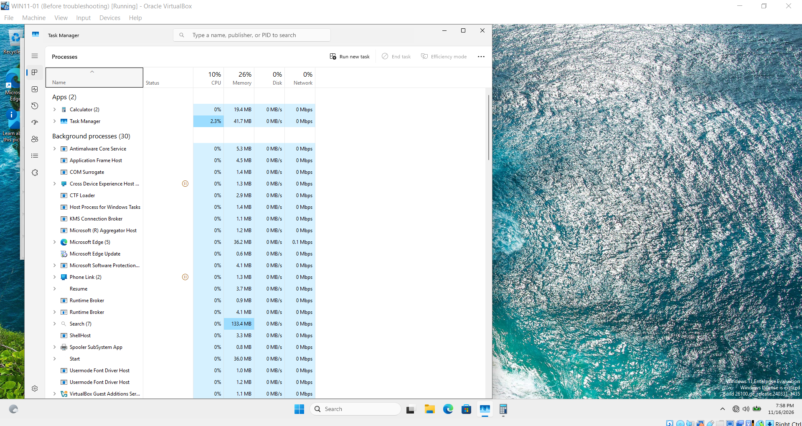
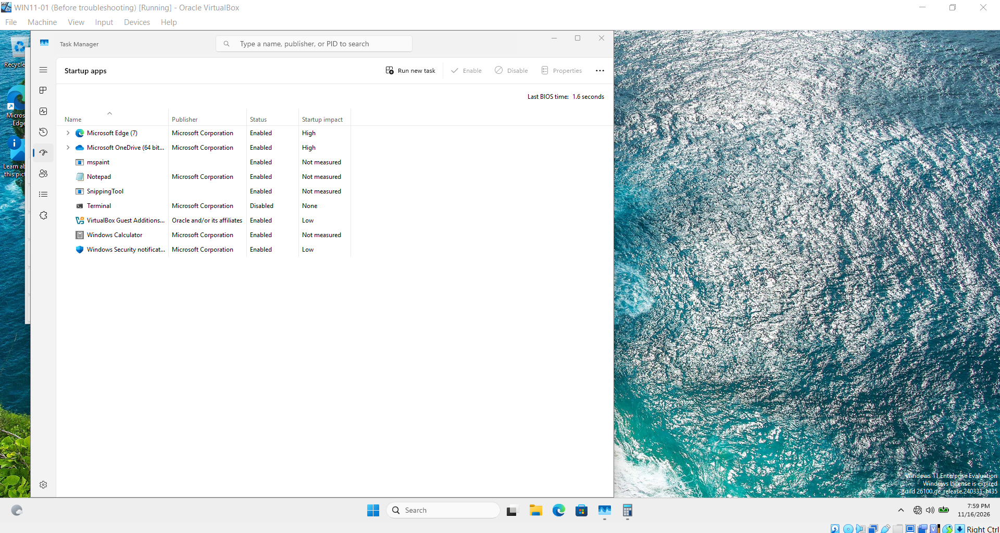
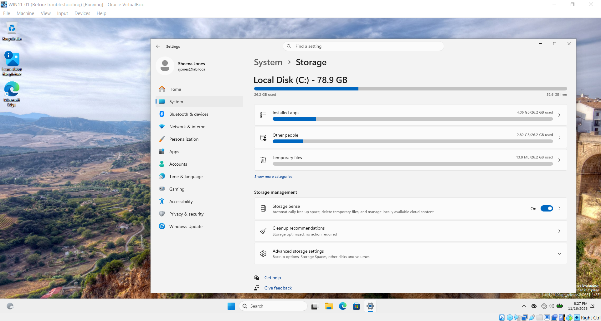
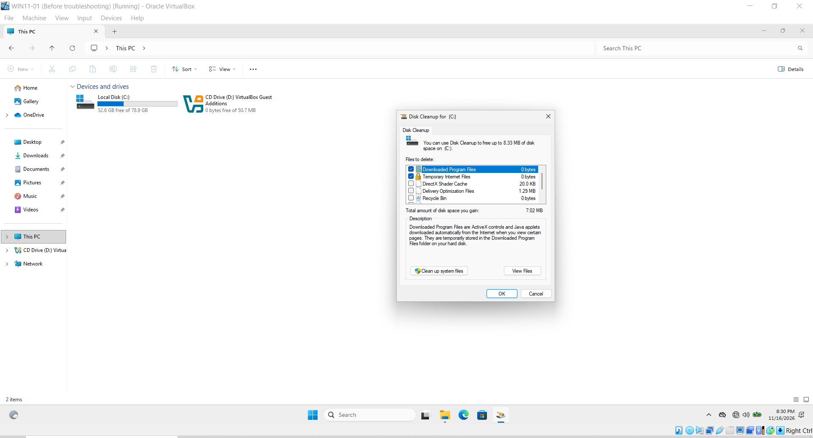
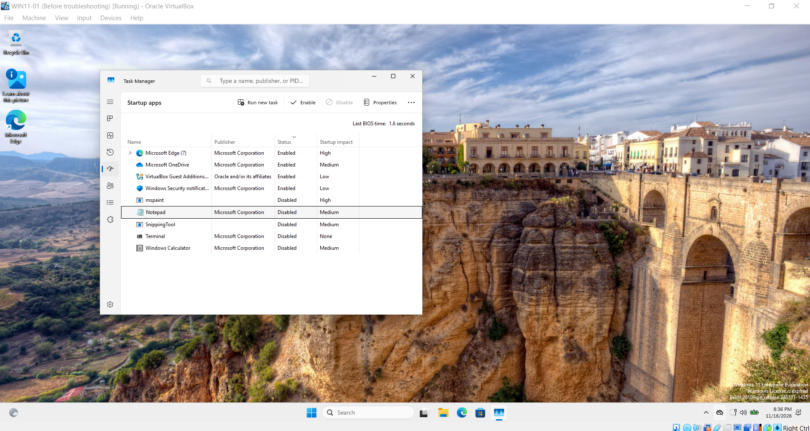

# Computer Is Slow

## Objective

I added several apps to the Startup folder on WIN11-01 to make it slower, then used Task Manager, Storage settings, and Disk Cleanup to find out what was using the system. I disabled the apps and checked that the startup list improved. This is the first of my Windows troubleshooting guides, and slow-computer tickets are one of the most common calls a Tier 1 help desk gets.

## Environment

- WIN11-01: Windows 11 Enterprise Evaluation, joined to `lab.local`
- VirtualBox 7.2.22
- Snapshot used for recovery: "Before troubleshooting"
- Accounts used: John Smith (first attempt) and Sheena Jones (second attempt)
- Tools: Task Manager, Settings > System > Storage, Disk Cleanup, Startup folder (`shell:startup`)

## Steps

**Part 1: Break the computer.** I pressed Windows + R, typed `shell:startup`, and created four shortcuts in the Startup folder: Calculator, Notepad, Paint, and Snipping Tool. These apps open at sign-in, so they add work to every startup.

**Part 2: Check the processes.** I opened Task Manager with Ctrl + Shift + Esc and went to the **Processes** tab. The top of the list showed the CPU at 10% and memory at 26%. The Calculator process was open from the startup shortcut.

**Part 3: Check the startup apps.** I opened the **Startup apps** tab. The list showed Microsoft Edge with a **High** startup impact and OneDrive with a **High** impact. My four shortcuts were all **Enabled**. Their impact showed as **Not measured** because the list hadn't measured them yet.

**Part 4: Check disk space.** Signed in as Sheena Jones, I opened **Settings > System > Storage**. Local Disk (C:) showed 26.2 GB used and 52.6 GB free out of 78.9 GB. Storage was not the problem.

**Part 5: Run Disk Cleanup.** I opened Disk Cleanup for C:. It could free 8.33 MB. Downloaded Program Files and Temporary Internet Files were empty. The visible items were Delivery Optimization Files at 1.29 MB and DirectX Shader Cache at 20 KB. Disk space was not the cause of the slowdown.

**Part 6: Fix it.** In the **Startup apps** tab, I selected mspaint, Notepad, SnippingTool, and Windows Calculator, and clicked **Disable** for each. Then I restarted WIN11-01 and checked the list again.

After the restart, the four shortcuts show as **Disabled**. Task Manager now measures their impact: mspaint is **High**, while Notepad, SnippingTool, and Calculator are **Medium**. That's because the apps had run at sign-in, so Task Manager could measure them.

## Troubleshooting

| Problem | What caused it | How I fixed it |
|---------|----------------|----------------|
| Settings would not open for John Smith. The Win + I shortcut and `Start-Process ms-settings:` both failed with "The app didn't start." | I did not find the cause. The Settings app opened without problems for another user, so the problem seems to be tied to that user's profile or account | I signed in as Sheena Jones, and Settings opened normally. The Storage check was done from her account |

## What I learned

- I learned that Disk Cleanup and free disk space don’t always explain a slow computer. My C: drive had 52.6 GB free, and Disk Cleanup could only free 8.33 MB, so I looked at startup load instead.

- I learned that when one user account behaves differently from another, I should test a second account before changing the computer itself.

