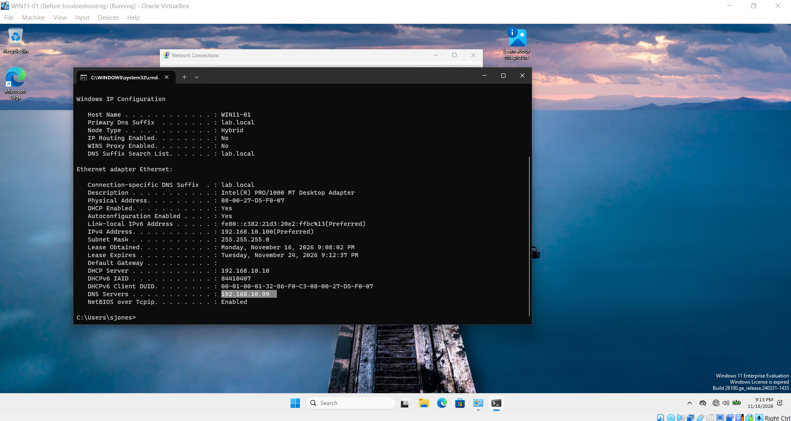
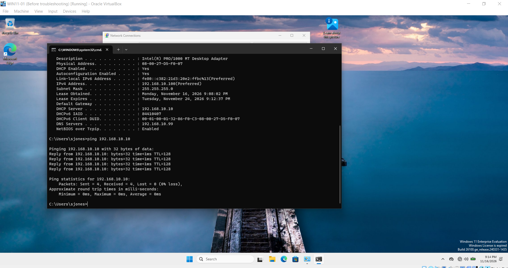
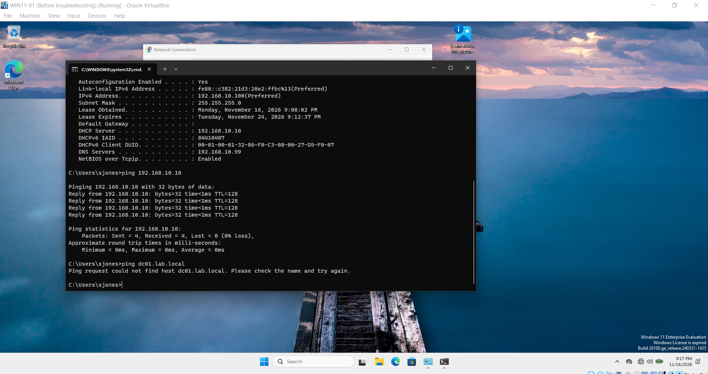
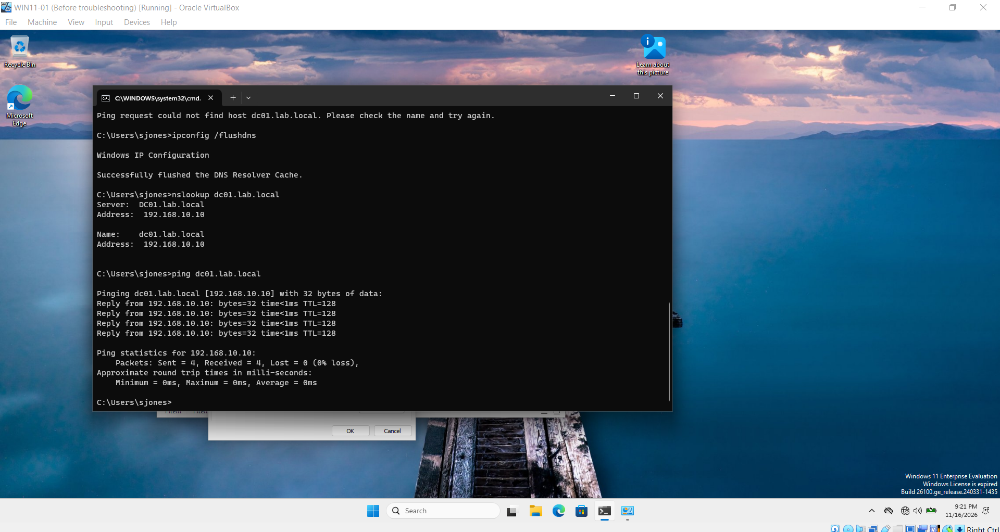
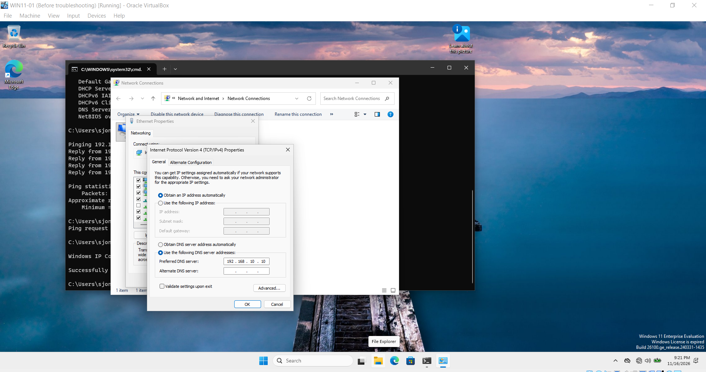

# No Network Name Resolution (Cannot Reach dc01.lab.local)

## Objective

I broke the DNS setting on WIN11-01 so the computer could still reach DC01 by IP address, but could not find it by name. Then I used `ipconfig`, `ping`, and `nslookup` to find the cause and set DNS back. "The computer has no internet" is one of the most common calls a Tier 1 help desk gets, and checking the network in order, from the IP address up to the name, is how I narrow it down quickly.

## Environment

- WIN11-01: Windows 11 Enterprise Evaluation, joined to `lab.local`
- DC01: Windows Server 2022 Standard Evaluation, DNS and DHCP server at `192.168.10.10`
- Network: internal network `labnet`, 192.168.10.0/24. The lab has no default gateway, so WIN11-01 can reach DC01 but not the internet.
- Snapshot used for recovery: "Before troubleshooting"
- Account used: Sheena Jones
- Tools: Network Connections (`ncpa.cpl`), Command Prompt, `ipconfig /all`, `ping`, `nslookup`

## Steps

**Part 1: Break the DNS setting.** I restored the "Before troubleshooting" snapshot, then pressed Windows + R, typed `ncpa.cpl`, and pressed Enter. I right-clicked **Ethernet**, chose **Properties**, selected **Internet Protocol Version 4 (TCP/IPv4)**, and clicked **Properties**. I left **Obtain an IP address automatically** selected, so the address still came from DHCP. I selected **Use the following DNS server addresses** and typed `192.168.10.99` as the Preferred DNS server. I clicked **OK**, then **Close**.

**Part 2: Confirm the problem.** I opened Command Prompt and ran three checks.

1. `ipconfig /all` showed the DNS Servers line set to `192.168.10.99`. The IPv4 address was still `192.168.10.100`, and the DHCP Server was `192.168.10.10`.

2. `ping 192.168.10.10` got four replies, so the network path to DC01 worked.

3. `ping dc01.lab.local` failed with "Ping request could not find host dc01.lab.local." The network was fine, but the name could not be resolved.

From these checks, the computer could reach DC01 by IP but could not turn the name into an address. That points to DNS, not the cable, the adapter, or DHCP.

**Part 3: Fix the DNS setting.** I opened **Network Connections** again with `ncpa.cpl`, went back to **Ethernet > Properties > Internet Protocol Version 4 (TCP/IPv4) > Properties**, and changed **Preferred DNS server** to `192.168.10.10`. I left **Obtain an IP address automatically** selected and clicked **OK**, then **Close**.

Then I ran these commands in Command Prompt:

1. `ipconfig /flushdns` cleared the old name lookups.
2. `nslookup dc01.lab.local` returned `Server: DC01.lab.local, Address: 192.168.10.10` and `Name: dc01.lab.local, Address: 192.168.10.10`. This shows that DC01 answered the lookup.
3. `ping dc01.lab.local` resolved to `192.168.10.10` and got four replies.

## Troubleshooting

I did not run into any other problems on this run. The wrong DNS server was the fault I added on purpose, so the fix was to set it back to the DNS server on DC01.

## What I learned

- I learned to check the network from the bottom up: first the IP address, then the path to DC01, then name resolution.

- learned that nslookup shows which DNS server answered a query, which tells me whether a client is using the right server.

- I learned that ipconfig /flushdns clears old name lookups, so I run it after a DNS fix before I test again.

