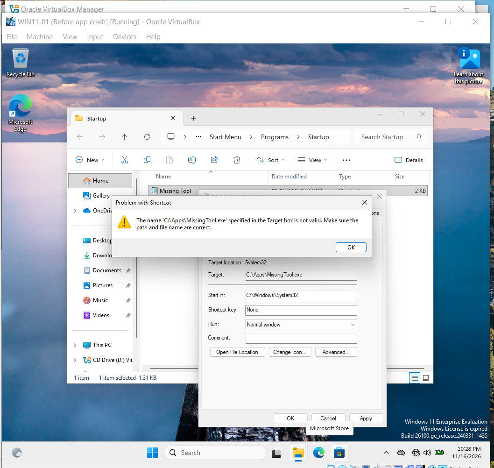
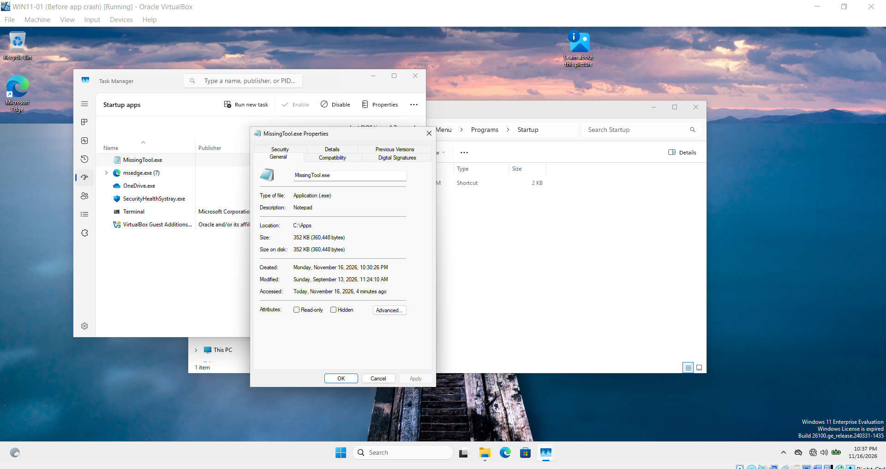
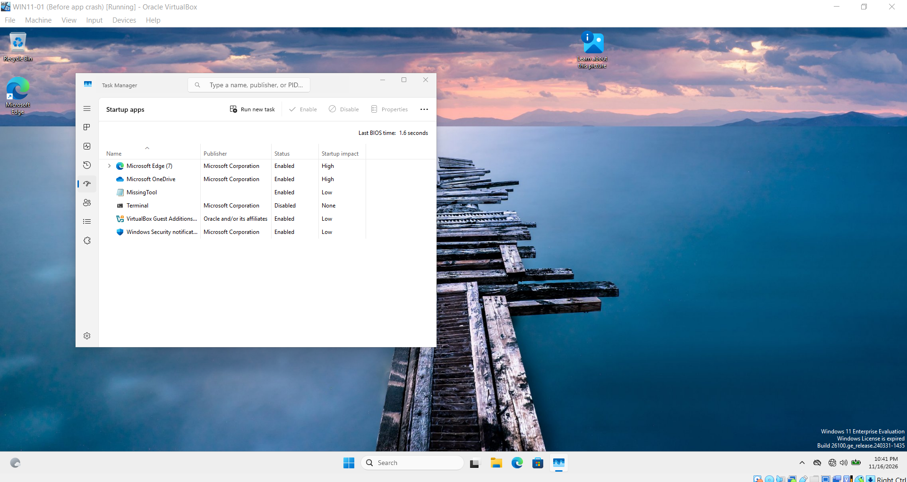
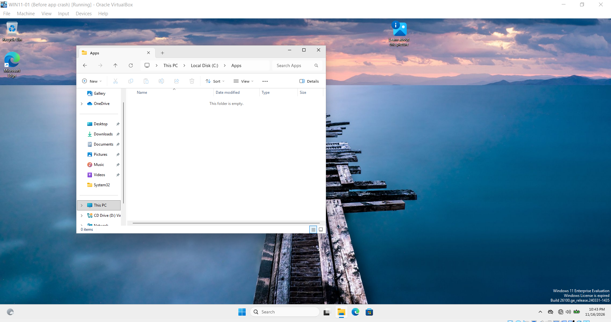
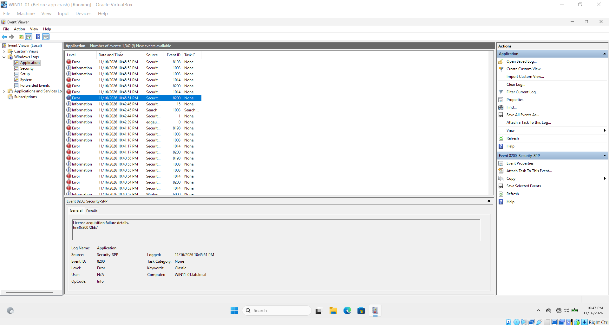
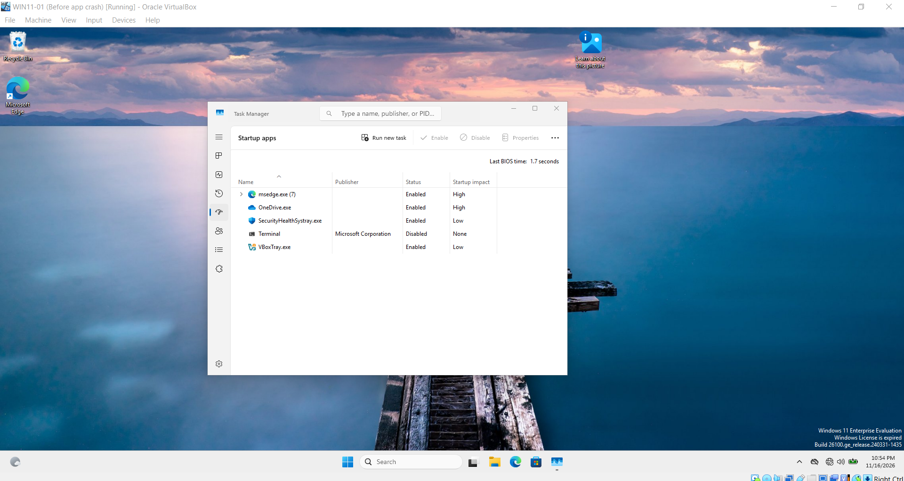

# App Fails to Start at Sign-In

## Objective

I created a Startup shortcut on WIN11-01 that pointed to a program that didn't exist, then tried to find out why it wasn't working. I expected an error message, but Windows didn't show one. This guide covers how I checked Task Manager, the Startup folder, and Event Viewer to find the broken item, and what I learned when the logs didn't show the failure. Apps that fail at sign-in are a common ticket, and knowing where to look is a big part of the job.

## Environment

- WIN11-01: Windows 11 Enterprise Evaluation, joined to `lab.local`
- Snapshot used for recovery: "Before app crash"
- Account used: Sheena Jones
- Tools: Startup folder (`shell:startup`), Task Manager, File Explorer, Event Viewer

## Steps

**Part 1: Break the startup item.** I pressed Windows + R, typed `shell:startup`, and created a shortcut named **Missing Tool**. Windows won't let you type a path to a missing file in the shortcut wizard, so I first pointed the shortcut at `C:\Windows\System32\notepad.exe`. Then I changed the Target box to `C:\Apps\MissingTool.exe`. Windows rejected that because the file didn't exist, so I did the following:

1. I created `C:\Apps` and copied `notepad.exe` into it as `MissingTool.exe`.
2. I set the shortcut's Target to `C:\Apps\MissingTool.exe` and clicked **Apply**. This time it saved.
3. I deleted `C:\Apps\MissingTool.exe` with Shift + Delete, so the target no longer existed.

**Part 2: Diagnose.** I signed out and signed back in, then checked three places.

1. **Task Manager, Startup apps.** The list showed **MissingTool** as **Enabled** with a **Low** startup impact. Windows still listed the entry even though its file was gone.

2. **File Explorer, C:\Apps.** The folder was empty ("This folder is empty"), so I confirmed the target file was missing.

3. **Event Viewer, Windows Logs > Application.** The log had over 1,300 events, and the newest errors were all from Security-SPP, with Event IDs 8198, 8200, and 1014. Those errors are about the expired Windows evaluation license, not the startup item. I didn't find any event that mentioned MissingTool, `C:\Apps`, or a startup failure.

**Part 3: Fix it.** The fix is to remove the broken startup entry. I opened the Startup folder with `shell:startup`, right-clicked **Missing Tool**, and chose **Delete**. The first sign-in after that still showed MissingTool in Startup apps, so I checked the folder again and confirmed the shortcut was still there. After I deleted it, I signed out and signed back in. Task Manager's Startup apps tab no longer lists MissingTool. The remaining entries are Microsoft Edge, OneDrive, SecurityHealthSystray, Terminal (Disabled), and VBoxTray.

## Troubleshooting

| Problem | What caused it | How I fixed it |
|---------|----------------|----------------|
| Windows would not save a Target path to a file that didn't exist | Windows checks that a shortcut's target exists before it saves the change | I copied a real program (`notepad.exe`) to `C:\Apps\MissingTool.exe`, set the target, and then deleted the copy |
| Event Viewer showed many errors, none about the startup item | The evaluation license has expired, so Security-SPP logs licensing errors during the session | I looked for events from the time of sign-in and checked the sources. The licensing errors are not the cause of the startup problem |

## What I learned

- A startup entry can point to a file that's gone and still show as Enabled in Task Manager. The Startup apps tab doesn't check that the target exists.
- Event Viewer doesn't always log a failed startup item. When the log shows nothing about the app, I check the Startup folder, the shortcut's Target, and the file path directly.
- A noisy log needs filtering. The licensing errors on this VM are unrelated to the startup problem, so I wrote them off rather than treating them as the cause.
- When I can't find an error, I write down exactly what I checked and what I didn't find, so the next person knows where I already looked.