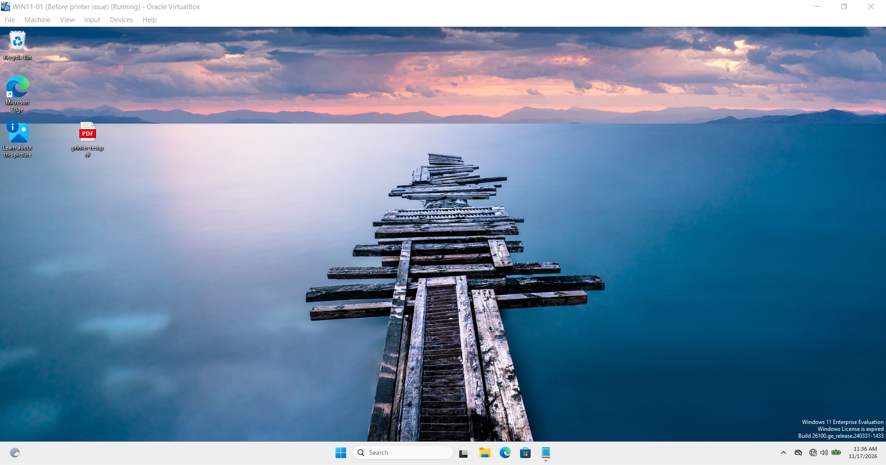
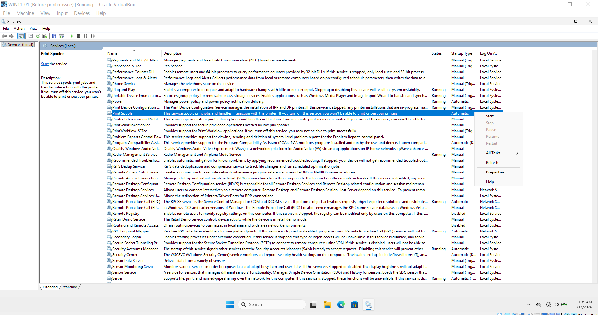
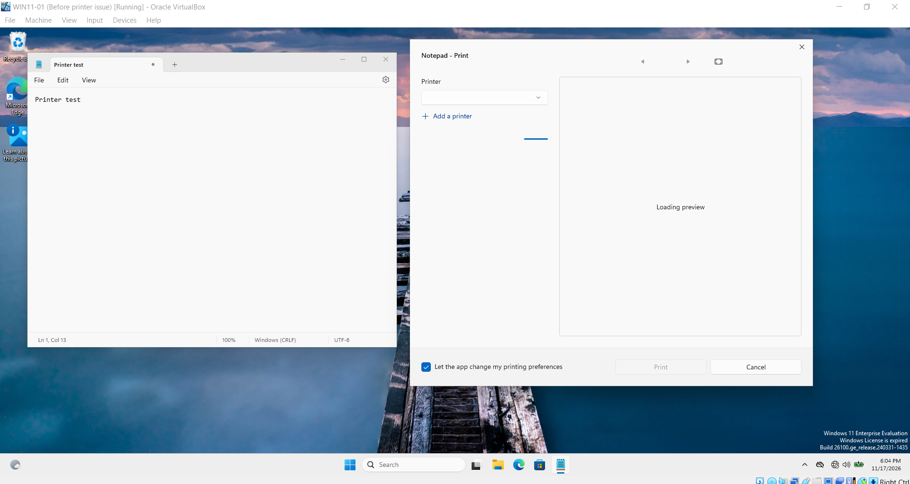
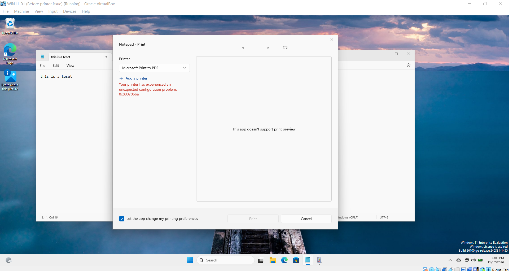
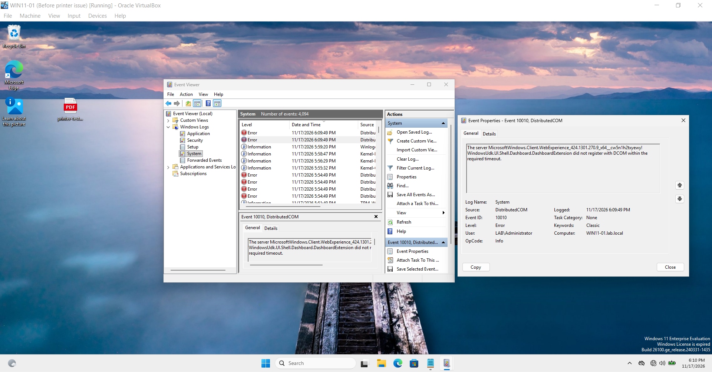
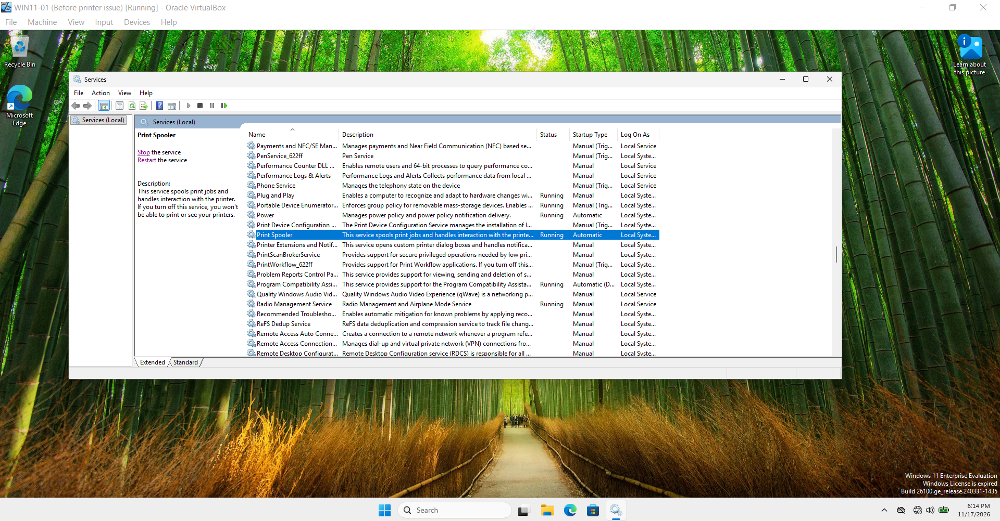
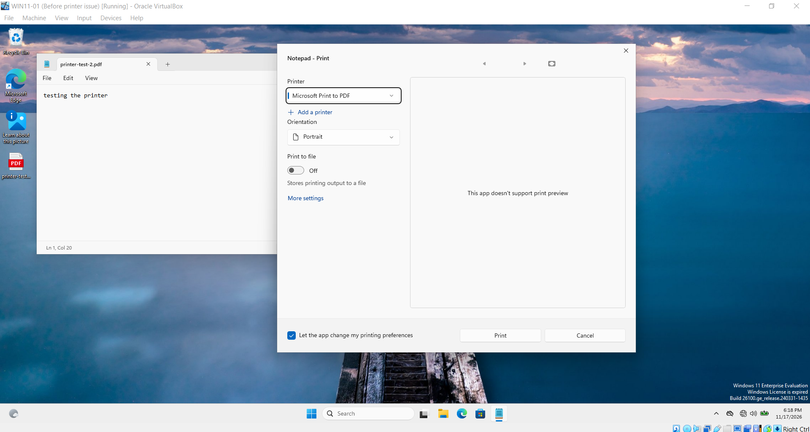

# Printing Fails Because the Print Spooler Stopped

## Objective

I stopped the Print Spooler service on WIN11-01, then tried to print from Notepad. Printing failed, and the print dialog showed no printers and an error code. I used the print dialog, services.msc, and Event Viewer to diagnose it, then started the service again and confirmed that printing worked. "Can't print" is one of the most common calls a Tier 1 help desk gets, and checking the print service is one of the first steps.

## Environment

- WIN11-01: Windows 11 Enterprise Evaluation, joined to `lab.local`
- Snapshot used for recovery: "Before printer issue"
- Accounts used: `lab\administrator` to change the service, and Sheena Jones to print
- Printer: Microsoft Print to PDF (built into Windows, so no network printer or internet is needed)
- Tools: Notepad, Services (`services.msc`), Event Viewer

## Steps

**Part 1: Confirm printing works.** As Sheena Jones, I opened Notepad, typed a test line, and printed to **Microsoft Print to PDF**. The PDF was saved to the Desktop, so I knew printing worked before I broke anything.

**Part 2: Break it.** I signed in as `lab\administrator`, pressed Windows + R, typed `services.msc`, and stopped the **Print Spooler** service. The Services window showed the status column blank for Print Spooler, and the right-click menu offered **Start** instead of **Stop**.

When I signed back in as Sheena Jones and opened the print dialog from Notepad, the printer list was blank and the preview showed "Loading preview."

**Part 3: Diagnose.** I printed again and got this error:

> Your printer has experienced an unexpected configuration problem. 0x800706ba

I opened **Event Viewer** and checked **Windows Logs > System**. I was looking for a Service Control Manager event (ID 7036) showing that Print Spooler had stopped. I didn't find one. The error I found was a DistributedCOM event (ID 10010) about a Windows dashboard component, which doesn't involve printing.

Because the print dialog couldn't find any printers and the error was an RPC error, I checked the Print Spooler service next.

**Part 4: Fix it.** I signed in as `lab\administrator`, opened `services.msc`, right-clicked **Print Spooler**, and chose **Start**. The Startup Type was already **Automatic**, and the status changed to **Running**.

Then I signed in as Sheena Jones, printed from Notepad again to **Microsoft Print to PDF**, and saved the file as `printer-test-2.pdf`. The file printed successfully.

## Troubleshooting

| Problem | What caused it | How I fixed it |
|---------|----------------|----------------|
| The print dialog showed no printers, and printing failed with error 0x800706ba | The Print Spooler service was stopped, so Notepad couldn't reach the printing service | I started Print Spooler in services.msc and confirmed it was Running. Printing then worked |
| I expected a Service Control Manager event (ID 7036) in Event Viewer, and didn't find one | Event Viewer doesn't always record a stopped service in the System log, or the event was not in the part of the log I checked | I used the error code and the Services window to confirm the problem. The DistributedCOM event I found (ID 10010) was about a Windows dashboard, not printing, so I ignored it |

## What I learned

- Printing that suddenly stops working can come from the Print Spooler service, not from the printer. I check services before I look at the printer.
- An error code like 0x800706ba describes what the app couldn't reach. It's a clue, not an answer. Here it pointed to the printing service.
- Services shows whether a service is running and whether it starts automatically. Both matter for printing.
- Not every event in Event Viewer relates to the problem. The DistributedCOM event looked like it could be relevant, but it was about a dashboard component. I check the source and the time, and I write down what I ruled out.
- Event Viewer doesn't always record a stopped service, so I don't rely on one log alone.