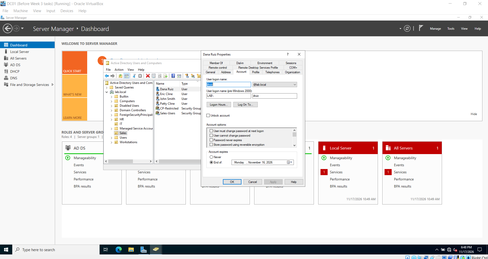
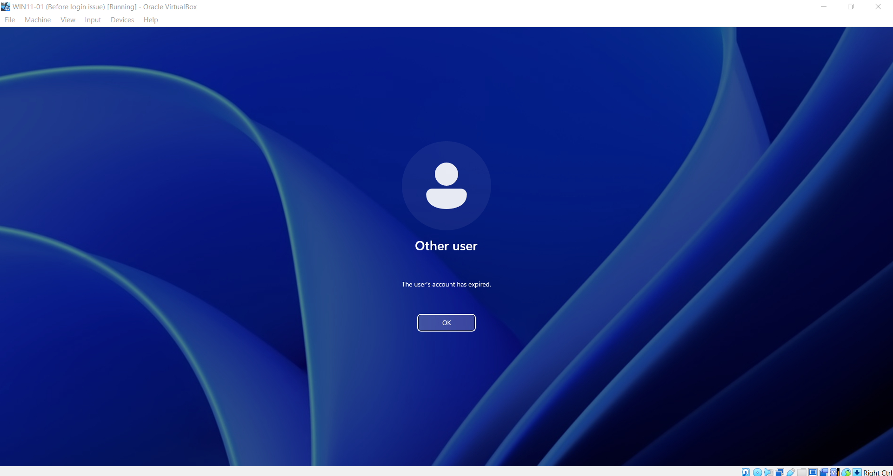
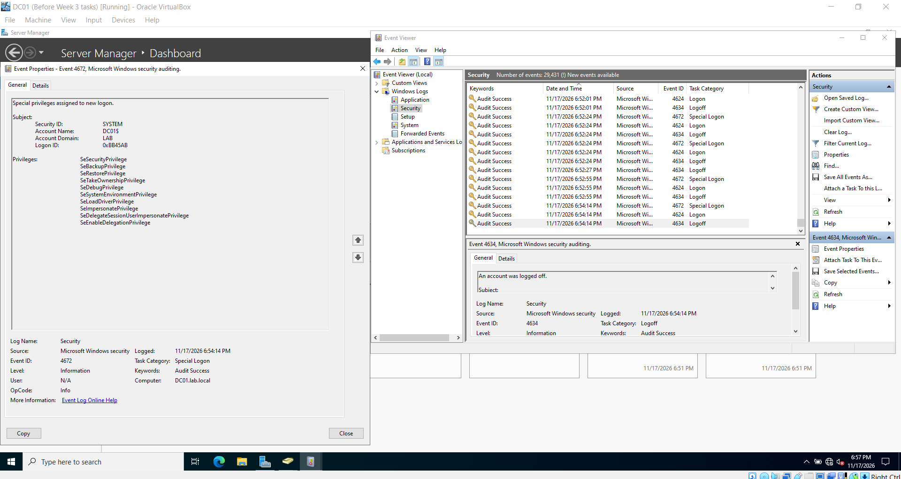
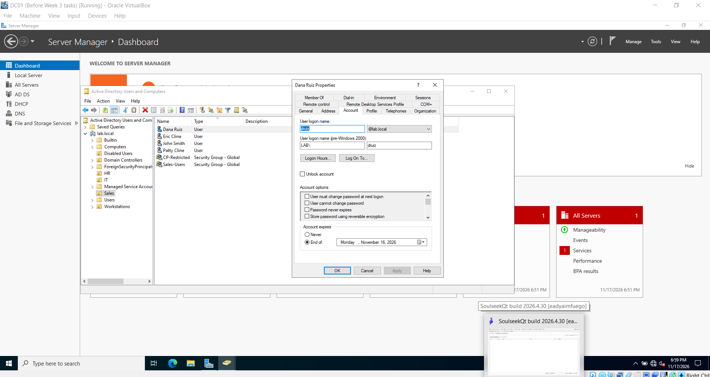
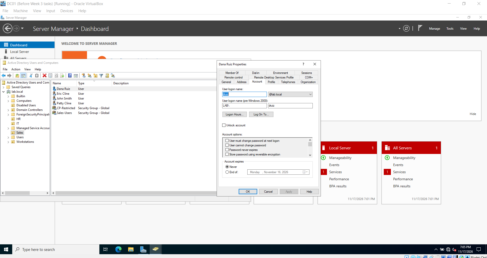
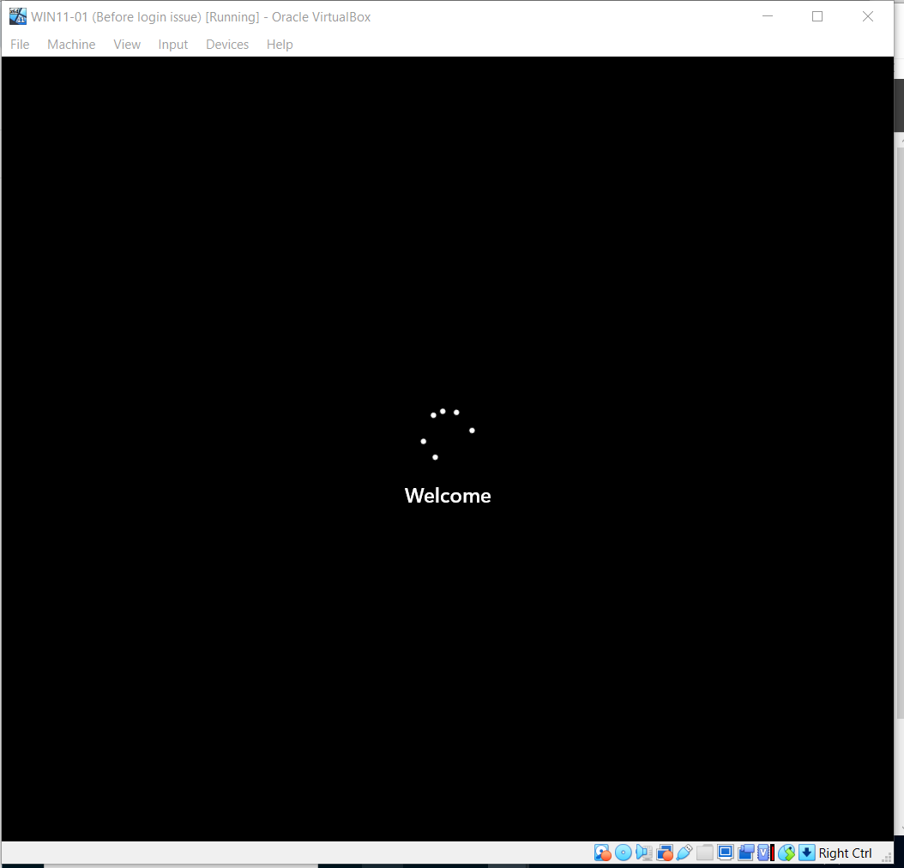
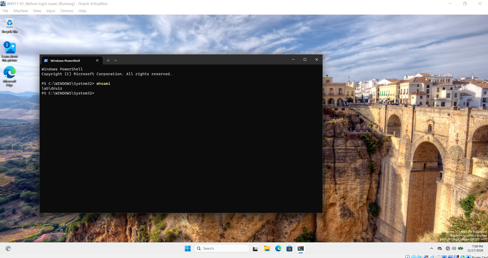

# User Cannot Log In Because the Account Expired

## Objective

I set an expiration date on a user's account in Active Directory so that the account would expire, then tried to sign in as that user on WIN11-01. Windows refused the sign-in and showed a message that the account had expired. I checked the account in Active Directory to confirm the cause, then set the expiration to Never. "I can't log in" is one of the most common calls a Tier 1 help desk gets, and checking the account settings on the domain controller is one of the first steps.

## Environment

- DC01: Windows Server 2022 Standard Evaluation, domain controller for `lab.local`
- WIN11-01: Windows 11 Enterprise Evaluation, joined to `lab.local`
- User: Dana Ruiz (`druiz`), in the Sales OU, created in the new hire guide
- Snapshot used for recovery: "Before login issue"
- Tools: Active Directory Users and Computers (ADUC), Event Viewer, the Windows sign-in screen, PowerShell (`whoami`)

## Steps

**Part 1: Break it (on DC01).** I signed in to DC01 as `lab\administrator`, opened **Active Directory Users and Computers**, expanded **lab.local > Sales**, and double-clicked **Dana Ruiz**. On the **Account** tab, I selected **End of** under **Account expires** and set the date to **11/16/2026**, which was the day before. I clicked **Apply**, then **OK**.

**Part 2: Confirm the sign-in fails (on WIN11-01).** I signed out, chose **Other user**, and signed in as `lab\druiz` with her password. Windows showed the message "The user's account has expired."

I also checked the Security log on DC01 in Event Viewer for a failed logon, Event ID **4625**, around the time of the sign-in attempt. I didn't find a 4625 event for that sign-in. The screenshot below shows a special logon (Event ID 4672) for the DC01 machine account, which doesn't relate to this sign-in.

**Part 3: Diagnose (on DC01).** I opened Dana Ruiz's properties again and checked the **Account** tab. **Account expires** was set to **End of Monday, November 16, 2026**, which is the cause of the sign-in failure.

**Part 4: Fix it (on DC01).** On the **Account** tab, I selected **Never** under **Account expires**, clicked **Apply**, then **OK**.

**Part 5: Confirm sign-in works (on WIN11-01).** I signed in as `lab\druiz` again. Windows didn't ask me to change the password. The sign-in screen showed the Welcome message, and PowerShell showed `lab\druiz` when I ran `whoami`.

## Troubleshooting

| Problem | What caused it | How I fixed it |
|---------|----------------|----------------|
| Sign-in failed with "The user's account has expired." | The **Account expires** date in ADUC was set to 11/16/2026, which was in the past | I set **Account expires** to **Never** on the Account tab and confirmed Dana could sign in |
| No failed logon (Event ID 4625) appeared in the DC01 Security log during the sign-in attempt | The expired account didn't create a 4625 event in the log I checked | I used the sign-in message on WIN11-01 and the Account tab in ADUC to confirm the cause. I didn't rely on the 4625 entry |

## What I learned

- An account can be disabled, locked, or expired, and each one gives a different message. "The user's account has expired" points to the expiration date, not the password.
- The Account tab in ADUC shows **Account expires**. I check it when a user can't sign in, not just the password or lockout status.
- Setting **Account expires** to **Never** keeps the account active. This is the setting for regular staff accounts.
- Event Viewer doesn't always show the event I expect. No 4625 event appeared for this failed sign-in, so I confirmed the cause another way, using the sign-in message and the account settings.
- A failed sign-in can be caused by the account rather than the computer. I check the account before I reset a password or rebuild the computer.