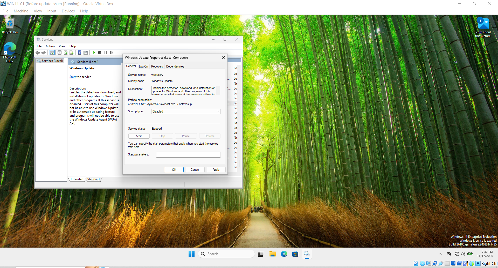
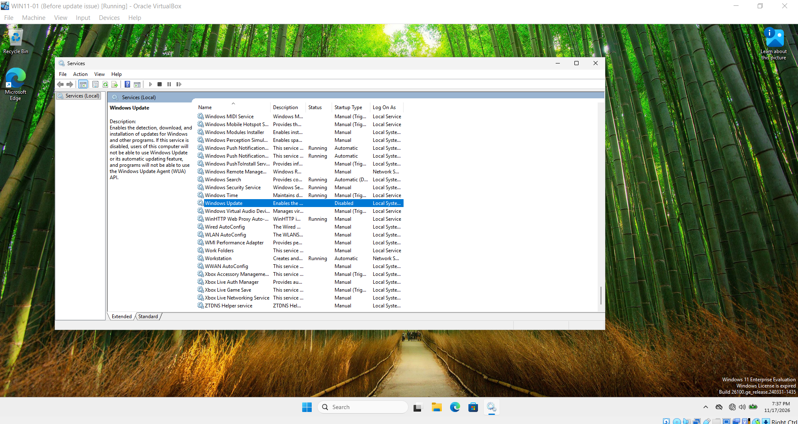
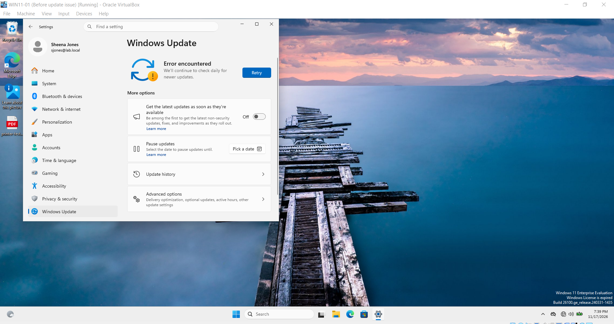
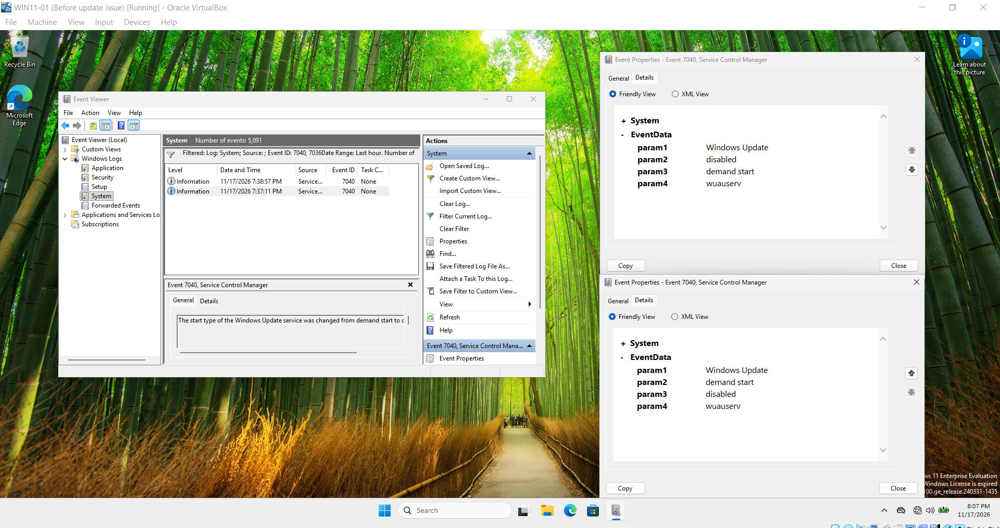
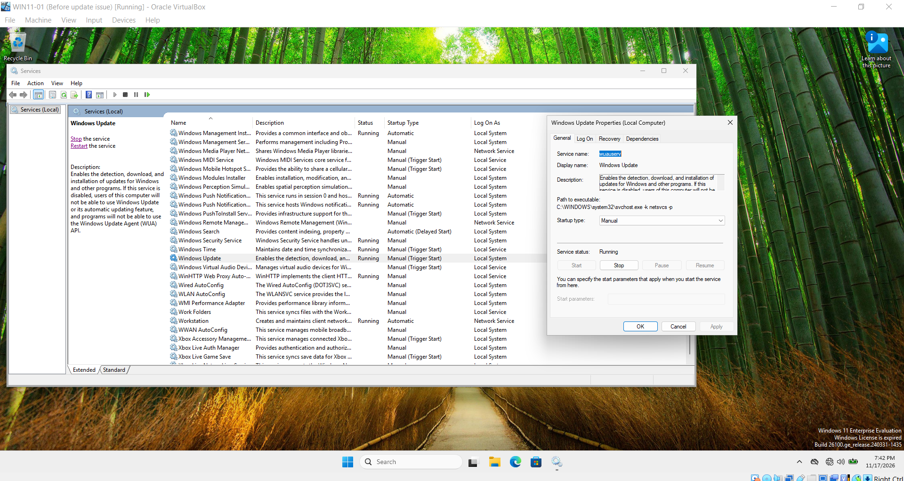
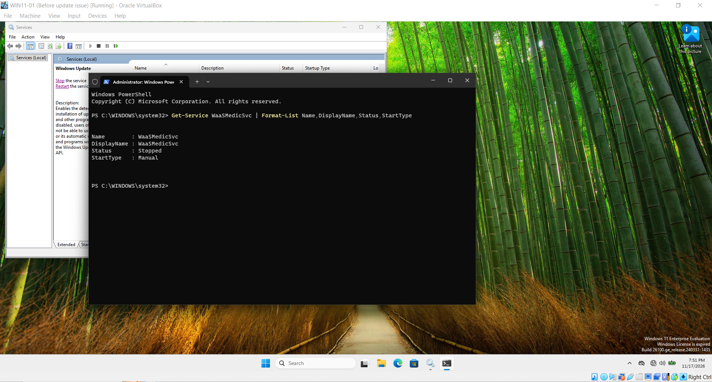
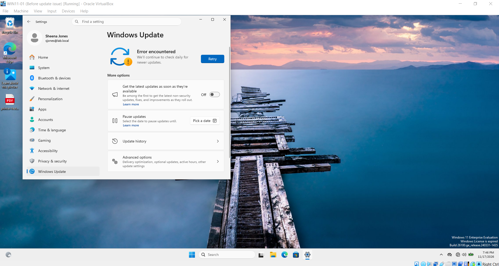
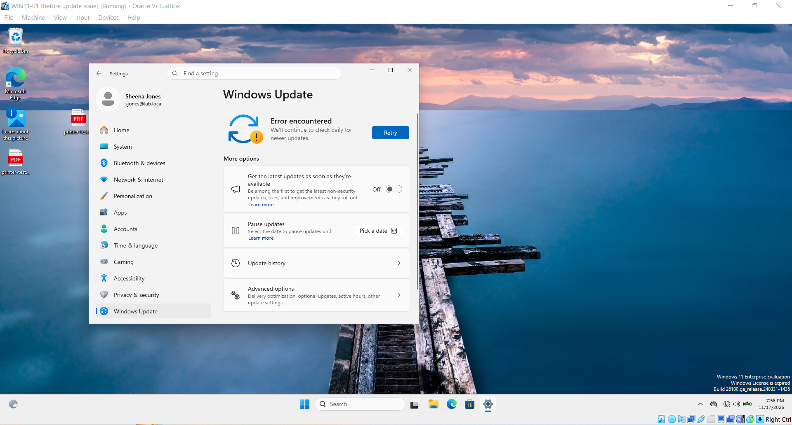
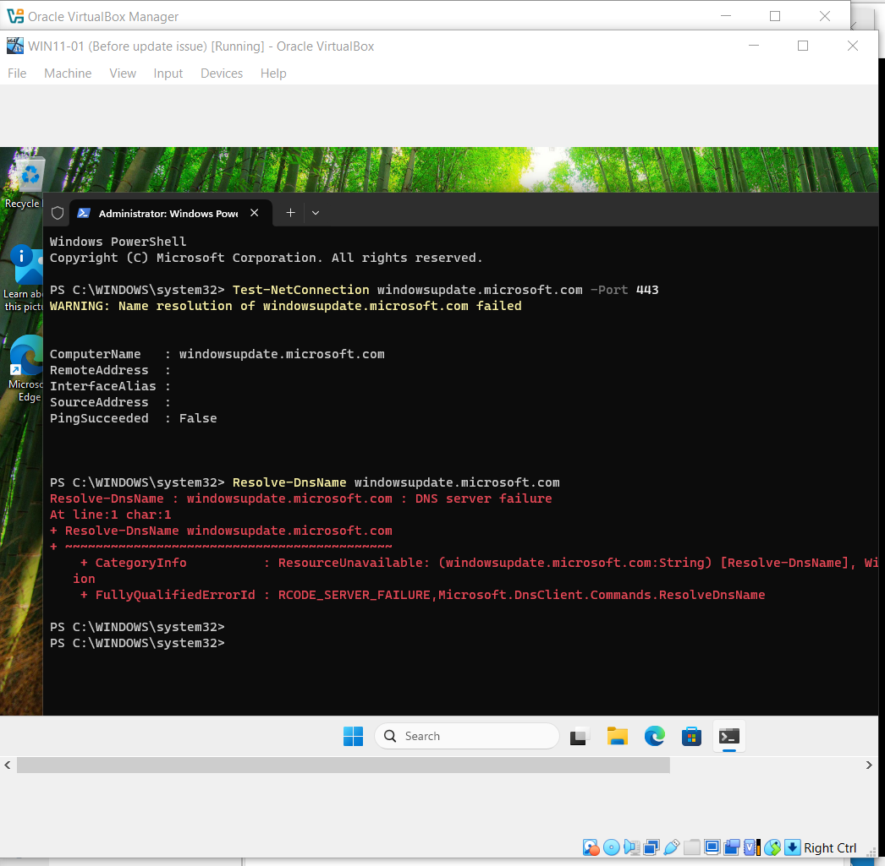

# Windows Update Shows an Error

## Objective

I wanted to learn how to tell a Windows Update problem caused by a stopped service from one caused by the network. I broke the Windows Update service on WIN11-01, looked at what Settings showed, then fixed the service and checked whether the error went away. "Windows Update isn't working" is a common help desk ticket, and I need to know whether to check the service or the connection first.

## Environment

- WIN11-01: Windows 11 Enterprise Evaluation, joined to `lab.local`
- Snapshot used for recovery: "Before update issue"
- Accounts used: `lab\administrator` to change the service, and Sheena Jones to check for updates
- Network: internal network `labnet`, 192.168.10.0/24, with no internet route
- Tools: Services (`services.msc`), Windows Update in Settings, PowerShell

## Steps

**Part 1: Break it.** I signed in as `lab\administrator`, opened `services.msc`, and stopped **Windows Update**. Then I opened its Properties, set **Startup type** to **Disabled**, and clicked **Apply**. The Services list showed the status as blank and the startup type as **Disabled**.





**Part 2: Diagnose.** I signed in as Sheena Jones and opened **Settings > Windows Update**. The page showed **Error encountered** with the message "We'll continue to check daily for newer updates." No error code was shown.



When I signed back in as `lab\administrator`, Windows Update showed **Manual (Trigger Start)** and **Running**. I hadn't changed it back. In Event Viewer, I filtered the System log for Service Control Manager Event ID 7040, which records a change to a service's start type. It showed two changes:

- At **7:37:11 PM**, the start type changed from demand start to **disabled**. That was my break.
- At **7:38:57 PM**, the start type changed from disabled back to **demand start**. That was about two minutes later, while Sheena Jones was signed in.

The event doesn't say what made the change, so the Windows Update Medic Service is still the likely cause, but I haven't proven it.





I checked the Windows Update Medic Service in PowerShell, which is the protected service that resets Windows Update. Services did not list it, so I used PowerShell. It showed `WaaSMedicSvc` as **Stopped** with **Manual** startup. I didn't change it, because it is a Windows service.



**Part 3: Fix the service.** I set Windows Update's **Startup type** back to **Manual** and clicked **Start**. The status changed to **Running**.


I signed in as Sheena Jones and opened Windows Update again. The page still showed **Error encountered**.



I clicked **Retry**, and the error came back.



**Part 4: Confirm the cause.** I signed in as `lab\administrator` and ran these commands in PowerShell:

```
Test-NetConnection windowsupdate.microsoft.com -Port 443
Resolve-DnsName windowsupdate.microsoft.com
```

The first command reported "Name resolution of windowsupdate.microsoft.com failed" and `PingSucceeded : False`. The second returned "DNS server failure." The computer can't look up Microsoft's update server, so it can't check for updates.



## Troubleshooting

| Problem | What caused it | How I fixed it |
|---------|----------------|----------------|
| Windows Update was Disabled, but it was Manual and Running again when I signed back in as the admin | Event 7040 shows Windows changed the start type back to demand start at 7:38:57 PM, about two minutes after my break. The event doesn't name what made the change. The Medic service is the likely cause, but not proven | I set Windows Update back to Manual and started it. I didn't change the Medic service |
| Settings still showed Error encountered after the service was running | The lab has no internet access, so the update check can't reach Microsoft. The name `windowsupdate.microsoft.com` doesn't resolve in this network | I confirmed the DNS failure with PowerShell. This is expected in the lab, so I documented it instead of trying to fix it |

## What I learned

- A Windows Update error can be a service problem, or it can be a network problem. I check the service first, then the connection.
- Windows can change protected update settings back to their defaults, so a disabled service may not stay disabled. I check it again after I sign in as a different account.
- `Test-NetConnection` and `Resolve-DnsName` tell me whether the computer can reach the update server by name and by port. Those two results are better evidence than the Settings message alone.
- In the lab, I can prove the update check is blocked by the network, but I can't make it succeed. The guide records that outcome.
- Some services can't be changed from Services. I use PowerShell to check them, and I don't change Windows-protected services as a Tier 1 technician.