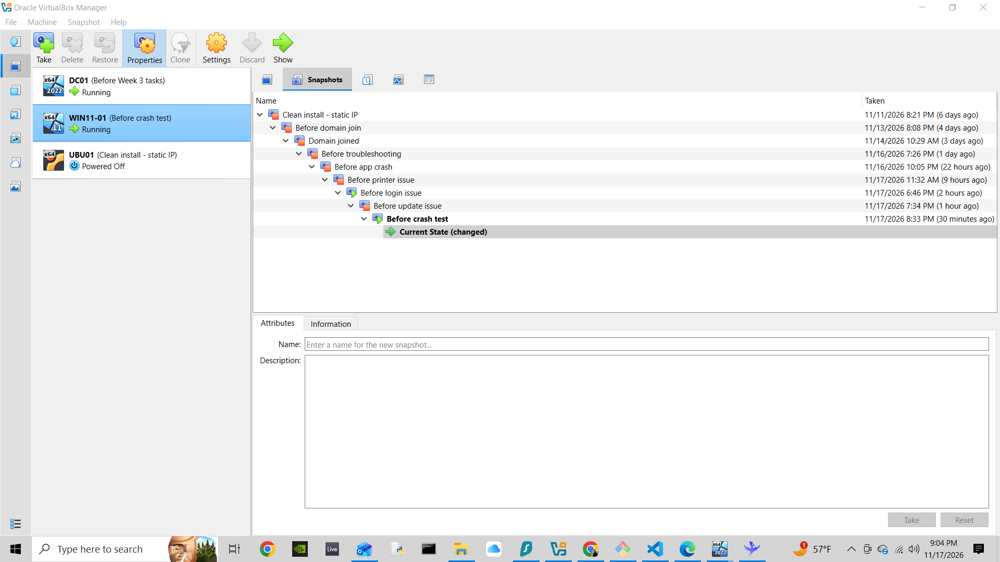
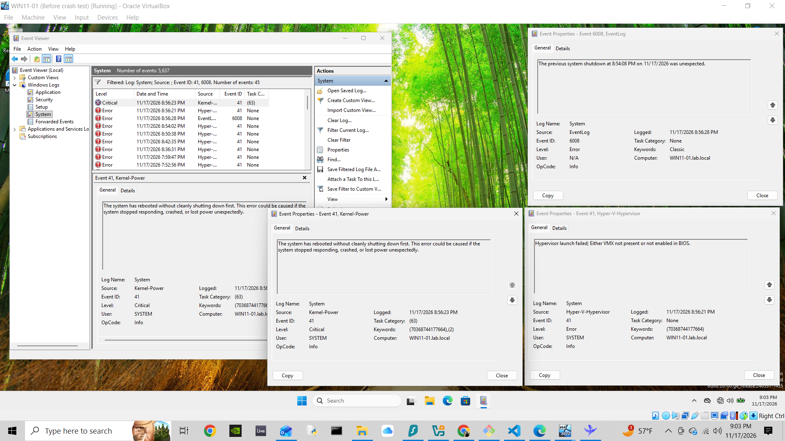
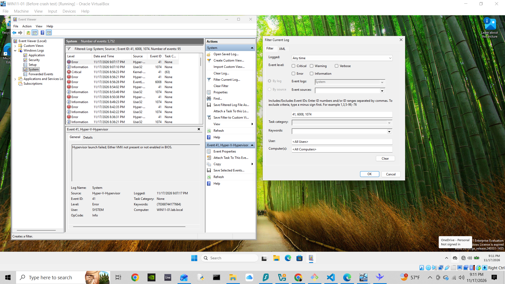

# Random Restarts: Finding the Unexpected Shutdown

## Objective

I wanted to learn how to tell when a computer restarted without shutting down cleanly, and how to find the event that shows it. I tried to trigger a blue screen first, but the keyboard trick didn't work in this lab. So I used VirtualBox's Reset option to restart WIN11-01 without a clean shutdown, then checked Event Viewer. "My computer keeps restarting" is a common help desk ticket, and the first step is to confirm whether Windows recorded an unexpected shutdown.

## Environment

- WIN11-01: Windows 11 Enterprise Evaluation, joined to `lab.local`
- VirtualBox 7.2.22, using Machine > Reset from VirtualBox Manager
- Snapshot taken before the test: "Before crash test"
- Account used: `lab\administrator`
- Tools: VirtualBox Manager, Event Viewer (System log, filtered for Event IDs 41 and 6008)

## Steps

**Part 1: Break it.** Before the test, I checked the registry for the earlier crash setting, `CrashOnCtrlScroll`, under `HKEY_LOCAL_MACHINE\SYSTEM\CurrentControlSet\Services\i8042prt\Parameters`. I didn't get a blue screen from it, so I deleted that value. Then I restarted WIN11-01. In VirtualBox Manager, I selected **WIN11-01**, clicked **Machine > Reset**, and confirmed. Reset works like pressing the reset button on a PC, so Windows didn't shut down cleanly.

**Part 2: Diagnose.** I signed in as `lab\administrator` and opened **Event Viewer**, then **Windows Logs > System**. I used **Filter Current Log** with Event IDs `41, 6008`. The filtered list had 45 events, and the newest ones were from the reset. I checked two events:

- **EventLog, Event ID 6008, at 8:56:28 PM:** "The previous system shutdown at 8:54:08 PM on 11/17/2026 was unexpected." This is the record that the shutdown wasn't clean.
- **Kernel-Power, Event ID 41, at 8:56:23 PM:** "The system has rebooted without cleanly shutting down first. This error could be caused if the system stopped responding, crashed, or lost power unexpectedly." This is the record of the unexpected reboot.

**Part 3: Fix it.** There isn't a real fix in this lab, because the reset was intentional. I'll document that the cause was the reset, and confirm a clean restart. I restarted WIN11-01 from the Start menu, then checked the filtered System log again. The newest event should be a normal shutdown, not a new 41 or 6008.

After the restart, I filtered the System log again for Event IDs 41, 6008, and 1074. The newest entry was **User32 Event 1074 at 9:07:10 PM**, which records a shutdown started from Windows. After it, the only new event was the Hyper-V-Hypervisor Event 41 at 9:07:17 PM, the same VM setup error from earlier boots. I didn't see a Kernel-Power Event 41 or Event 6008 after the clean shutdown, so the restart was clean.

## Troubleshooting

| Problem | What caused it | How I fixed it |
|---------|----------------|----------------|
| The blue screen trick didn't work. Pressing left Ctrl and Scroll Lock twice didn't crash the computer | The VM's keyboard input or the registry setting didn't trigger the crash. I didn't find the exact cause | I switched to a hard reset from VirtualBox, which produces an unexpected shutdown without needing the keyboard |
| Event 41 from Hyper-V-Hypervisor said "Hypervisor launch failed; Either VMX not present or not enabled in BIOS" | The lab VM's virtualization setting doesn't give it access to hardware virtualization. This is a VM setup issue, not a Windows fault | I didn't change it. It's a separate error from the reset, so I documented it and didn't count it as the restart cause |

## What I learned

- Event ID **6008** tells me the previous shutdown was unexpected, and Event ID **41** from Kernel-Power tells me the system rebooted without a clean shutdown. I check both together.
- The time on the 6008 event tells me when the last shutdown happened, so I can match it to what the user was doing.
- Not every Event 41 is the same. The Hyper-V-Hypervisor 41 is a virtualization error, and I can tell it apart by its source.
- A hard reset is a good way to test restart logging in a lab, but it isn't a fix. The fix for real random restarts depends on the cause, such as drivers, overheating, or power.
- I don't claim a cause until the event shows one. The events here show an unexpected restart, not what caused it.