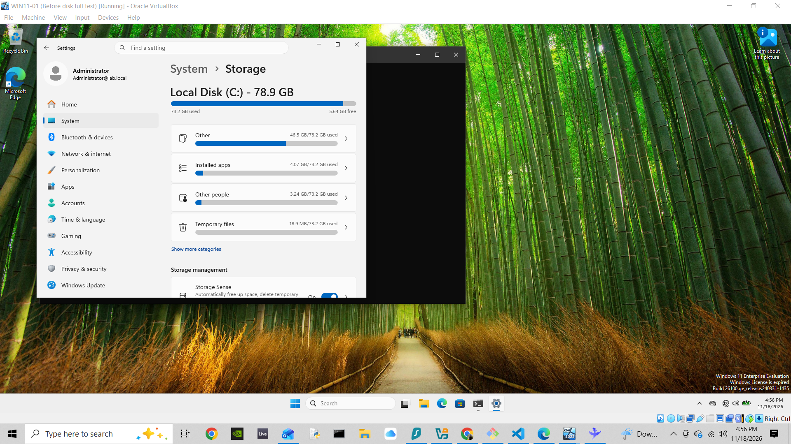
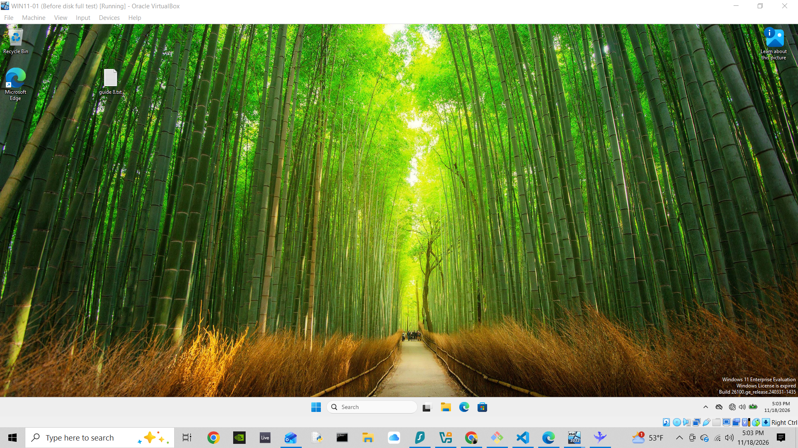
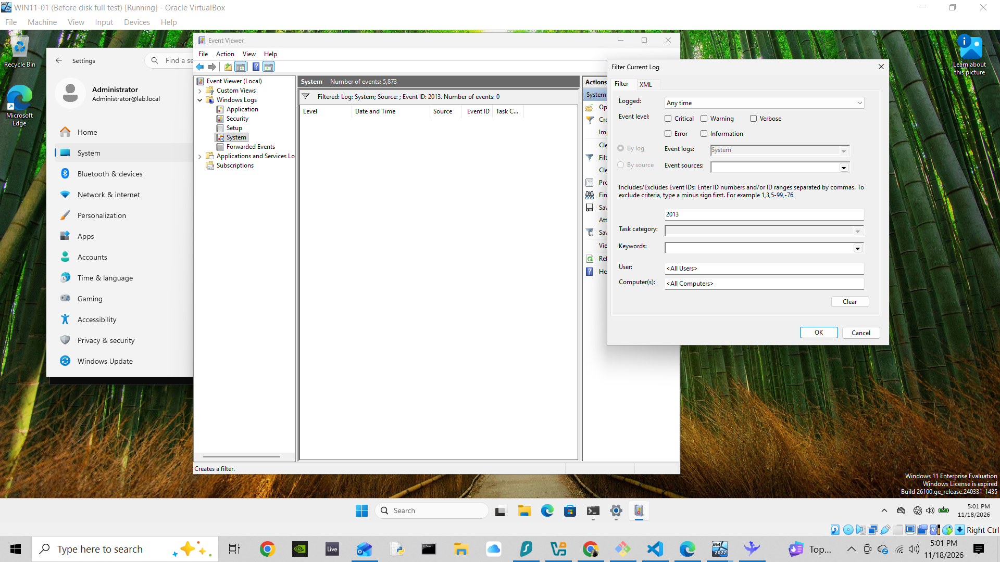
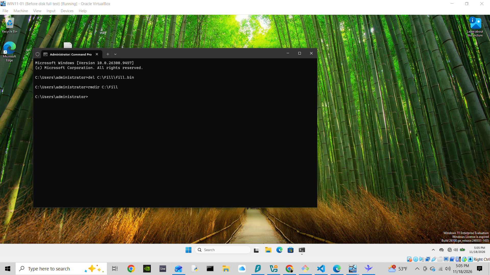
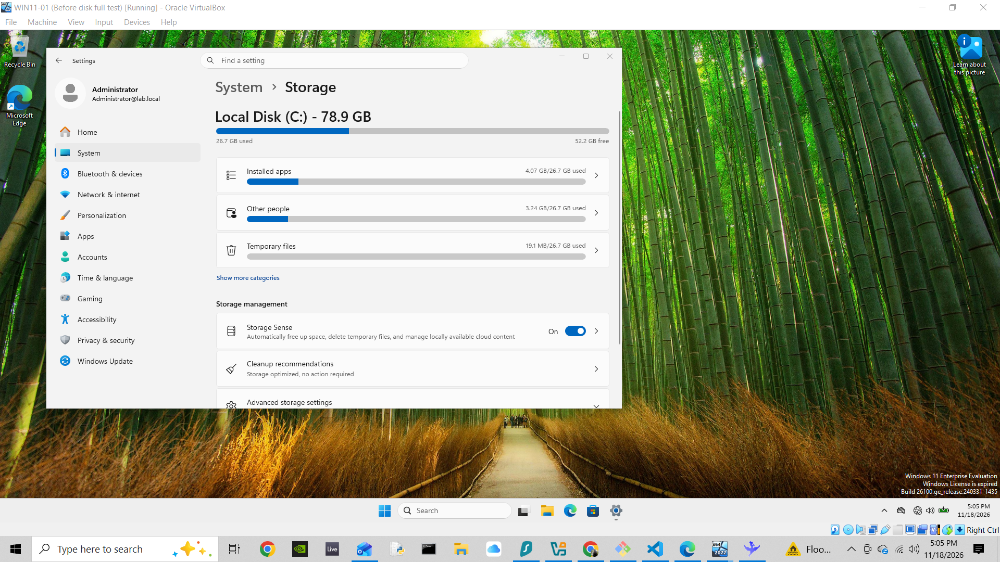

# Disk Full: Finding Where the Space Went

## Objective

I wanted to learn how to tell when a computer is running out of disk space, and how to find what is using it. I filled most of the C: drive on WIN11-01 with a large test file, then checked Storage settings and Event Viewer for a low-disk warning. Running out of space is a common help desk ticket, and I need to see which category is taking the space before I decide what to delete.

## Environment

- WIN11-01: Windows 11 Enterprise Evaluation, joined to `lab.local`
- Snapshot used for recovery: "Before disk full test"
- Account used: `lab\administrator`
- Tools: Command Prompt (`fsutil`), Settings > System > Storage, Event Viewer (System log, Event ID 2013)

## Steps

**Part 1: Break it.** I opened Command Prompt as administrator and created a folder called `C:\Fill`. Then I ran `fsutil file createnew C:\Fill\fill.bin 50000000000` to create a file of about 50 GB. Storage showed the disk at 73.2 GB used and 5.64 GB free, out of 78.9 GB.

**Part 2: Diagnose.** I checked three places.

1. **Storage settings.** The **Other** category had grown to **46.5 GB**, which is where the test file was counted. Installed apps, Other people, and Temporary files were all unchanged. Looking at the categories showed me where the space went.
2. **Event Viewer.** I filtered the System log for Event ID **2013**, which is the event for a disk at capacity. The filter returned **0 events**, so the low-disk condition didn't create a log entry.
3. **Saving a file.** I saved a test file to the Desktop, and Windows didn't show any warning or error. The disk still had 5.64 GB free, so it wasn't actually full.

**Part 3: Fix it.** I ran `del C:\Fill\fill.bin` and then `rmdir C:\Fill` in Command Prompt. Then I checked Storage again. The free space went back up to **52.2 GB** of 78.9 GB.

## Troubleshooting

| Problem | What caused it | How I fixed it |
|---------|----------------|----------------|
| No Event 2013 appeared, and Windows showed no warning when I saved a file | The disk still had 5.64 GB free. Windows raises the low-disk warning only when free space gets much lower, so this fill wasn't enough to trigger one | I used Storage settings to find the cause. The Other category showed the 46.5 GB file |

## What I learned

- The Storage categories show where the space went. A sudden jump in **Other** pointed to the cause here.
- A disk can be heavily used without being full. I check the free space number before I assume a warning should appear.
- Event 2013 is useful only when the disk is actually at capacity. Its absence doesn't mean the disk is fine, so I also check Storage.
- Deleting the file from Command Prompt restored the space right away, which confirms the cause.