# Network Troubleshooting: Wrong Gateway and a Disabled Switch Port

## Objective

I wanted to learn how to find a network problem by working from the nearest device outward. I built a small network in Cisco Packet Tracer with a router, a switch, two PCs, and a server, then broke it two ways. I used `ipconfig`, `ping`, `tracert`, and switch commands to find each problem. "The computer can't reach the server" is a common help desk ticket, and checking the gateway and the switch port first saves a lot of time.

## Environment

- Packet Tracer: router 1941 (Router0), switch 2960 (Switch0), PC1, PC2, and Server0
- Router interfaces: GigabitEthernet0/0 (192.168.20.1) to the switch, GigabitEthernet0/1 (192.168.30.1) to the server
- Switch ports: Fa0/1 goes to the router, Fa0/3 goes to PC1 (I confirmed this with `show mac address-table`)
- PC1: 192.168.20.10, gateway 192.168.20.1, MAC `0030.F2B0.C793`
- PC2: 192.168.20.11, gateway 192.168.20.1
- Server0: 192.168.30.10, gateway 192.168.30.1
- Tools: PC Command Prompt (`ipconfig`, `ping`, `tracert`), router and switch CLI

## Steps

**Part 1: Build and configure the network.** I connected both PCs to the switch, the switch to the router's GigabitEthernet0/0 port, and the server to GigabitEthernet0/1. On the router, I set the two interface addresses and turned both on with `no shutdown`. `show ip interface brief` showed both interfaces **up** and **up**. I checked it again later and both were still up.

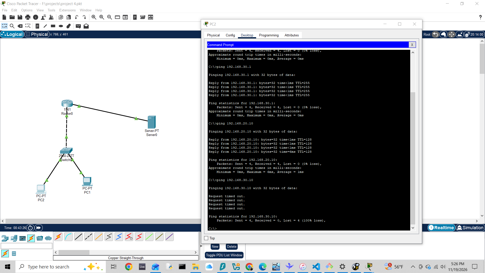

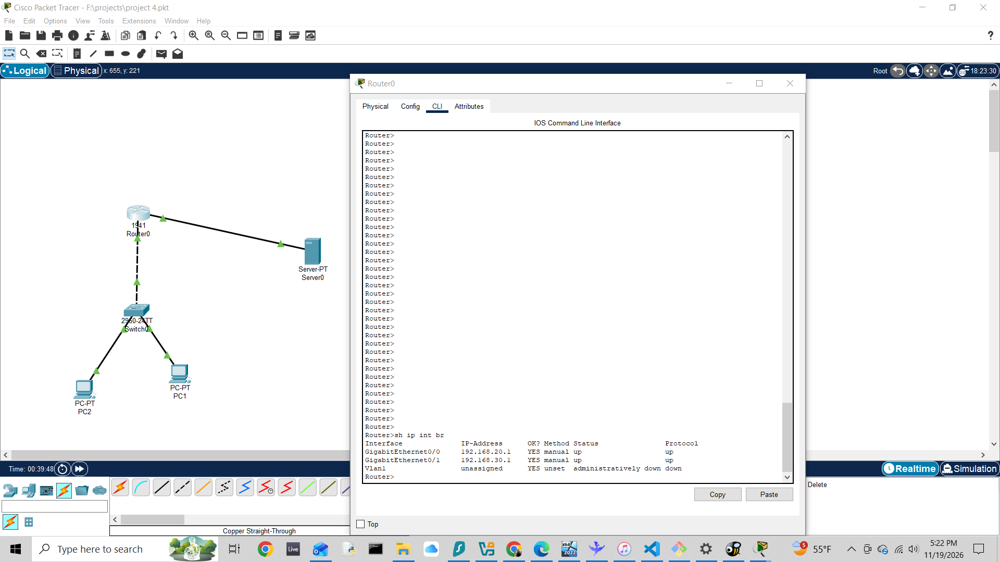

**Part 2: Baseline test.** I set PC1 and the server to the addresses above. From PC1, `ping 192.168.20.1` (the router on its own network) and `ping 192.168.30.10` (the server, through the router) both replied.

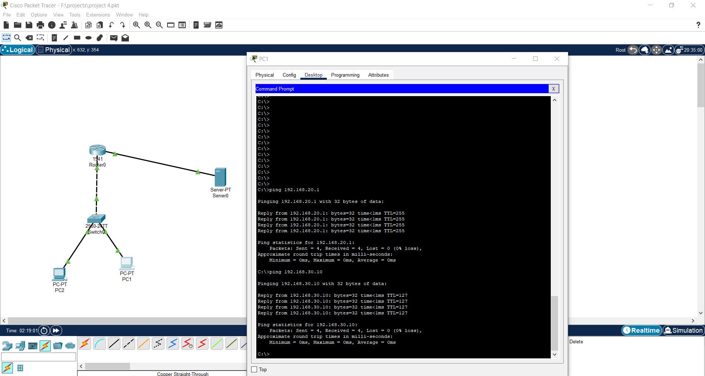

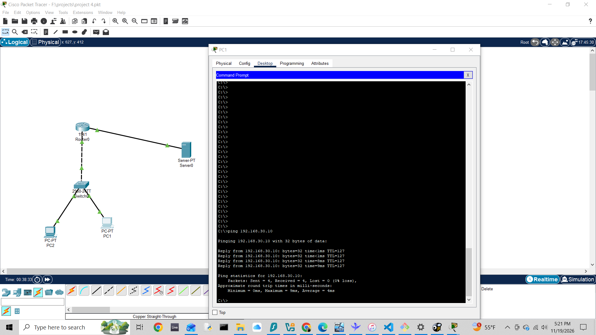

**Part 3: Break scenario A (wrong gateway).** I changed PC2's default gateway to `192.168.20.254`, an address that doesn't exist on the network.

**Part 4: Diagnose scenario A.** I ran these checks from PC2:

1. `ipconfig` showed the default gateway as `192.168.20.254`, which is wrong.
2. `ping 192.168.20.10` (PC1, on the same network) replied, so the local network and switch work.
3. `ping 192.168.30.1` replied in one run, which should not happen if the gateway is wrong. I wrote this down as a surprise, because the router should not answer through a wrong gateway. I haven't explained it yet. In a later run, the same ping timed out, so I'll check it again.
4. `ping 192.168.30.10` (the server) timed out.
5. `tracert 192.168.30.10` timed out at every hop, so the trace didn't get past PC2.

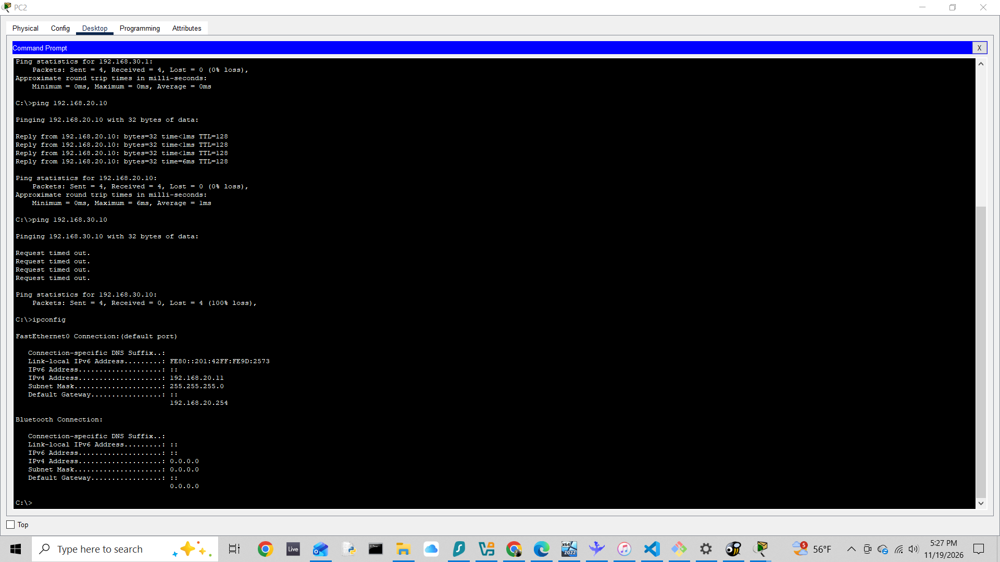

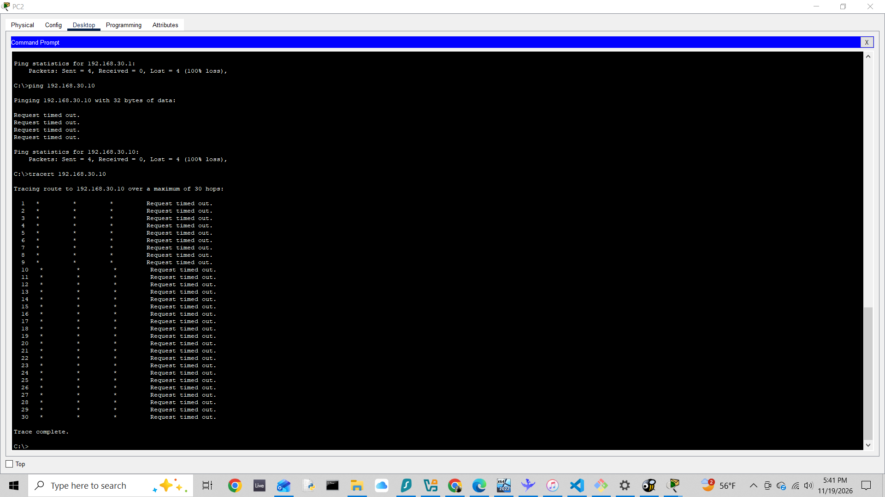

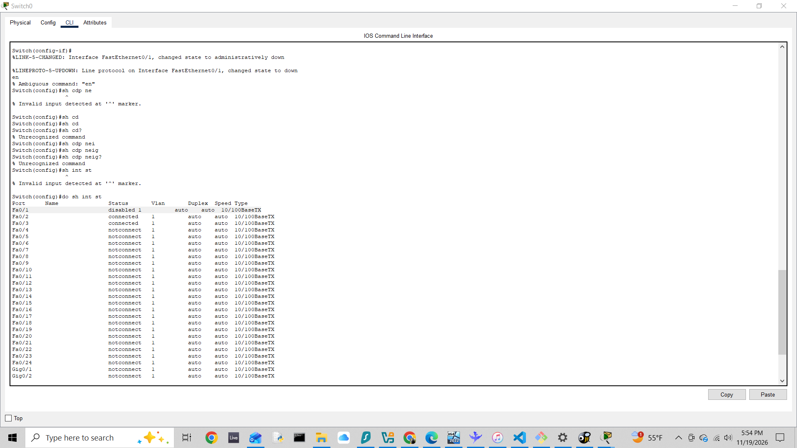

**Part 5: Fix scenario A.** I set PC2's default gateway back to `192.168.20.1`. `ipconfig` showed the correct gateway, and `ping 192.168.30.10` replied 4 times, with 0% loss.

**Part 6: Baseline for scenario B (find PC1's switch port).** Before I broke anything, I checked which port PC1 was on. On the switch, `show mac address-table` showed PC1's MAC `0030.f2b0.c793` on **Fa0/3**. `show cdp neighbors detail` showed the router on **Fa0/1**, connected to its GigabitEthernet0/0 port. `show interfaces status` showed Fa0/1, Fa0/2, and Fa0/3 all **connected**.

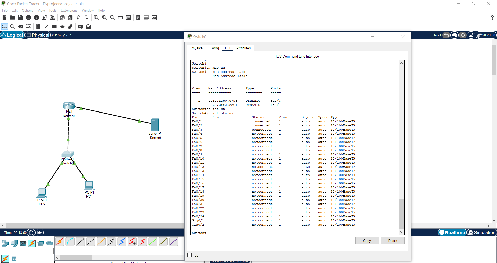

From PC1, `ping 192.168.20.1` and `ping 192.168.30.10` both replied again.

My first try broke the wrong port. I shut down Fa0/1, which is the router's uplink, not PC1's port. The result didn't match the test I wanted, so I checked the MAC table, found PC1 on Fa0/3, and redid the test there.

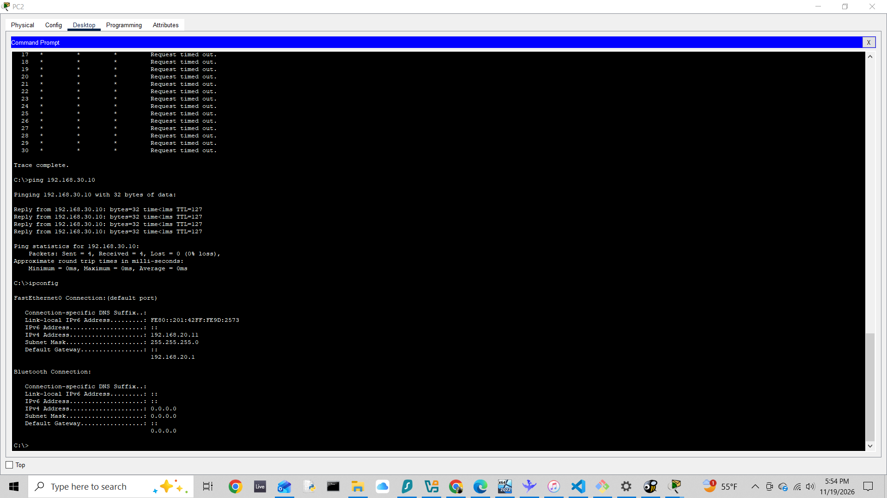

**Part 7: Break scenario B (PC1's switch port down).** I entered `interface FastEthernet0/3` and then `shutdown` on the switch. The switch logged that FastEthernet0/3 changed to administratively down, and the line protocol went down with it. `show interfaces status` showed **Fa0/3** as **disabled**.

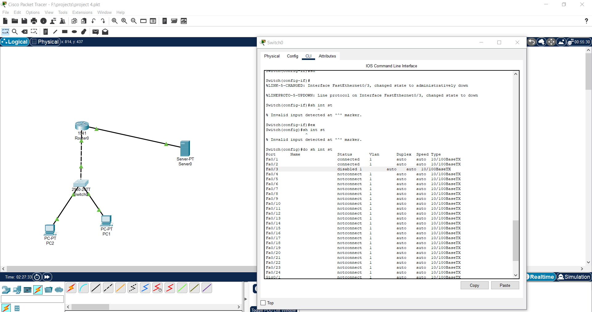

**Part 8: Diagnose scenario B.** From PC1, `ping 192.168.20.1` timed out on all four requests, with 100% loss. The Packet Tracer topology showed a down marker on the link between the switch and PC1, which matches the port that's disabled.

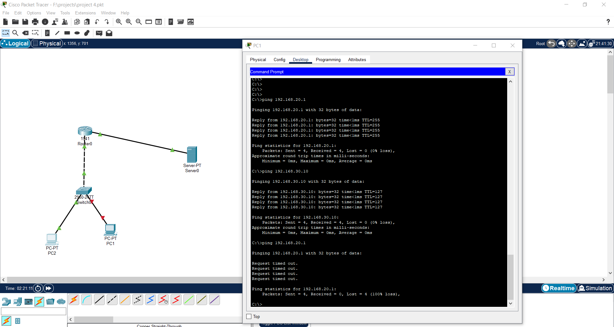

**Part 9: Fix scenario B.** I entered `interface FastEthernet0/3` and `no shutdown` on the switch. Then I pinged again from PC1. The first request timed out while the port came back up, and the next requests replied. The ping to the server replied 4 times, with 0% loss.

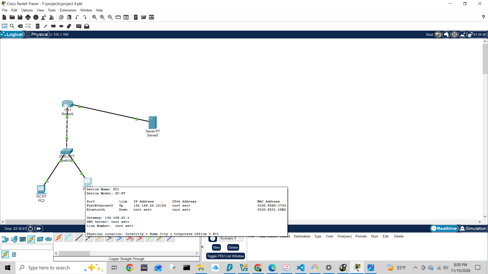

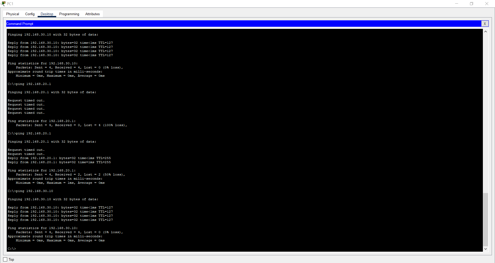

## Troubleshooting

| Problem | What caused it | How I fixed it |
|---------|----------------|----------------|
| PC2 couldn't reach the server, but could reach PC1 | PC2's default gateway was set to `192.168.20.254`, which doesn't exist | I set the gateway back to `192.168.20.1`, then pinged the server to confirm |
| `tracert` timed out at every hop | The first hop was PC2's gateway, which didn't exist, so the trace never reached the router | I fixed the gateway, then the ping to the server worked |
| PC1 couldn't reach the router or the server | I shut down switch port Fa0/3, which PC1 is connected to | I used `no shutdown` on Fa0/3, then pinged the router and server to confirm |

## What I learned

- I test from the nearest device outward: the PC's own settings first, then the local network, then the router, then the destination.
- `ipconfig` tells me the gateway, and a wrong gateway is a common cause of "I can reach some things but not others."
- `tracert` shows where traffic stops. If it times out at the first hop, the problem is at the PC or its gateway.
- `show mac address-table` tells me which switch port a PC is on, and `show cdp neighbors detail` tells me what's on each port. I check both before I break anything, so I know which port to test.
- `show interfaces status` on the switch shows whether a port is connected or disabled, and it's the first check when a single PC loses its connection.
- When one PC times out to the router and the switch port is disabled, the problem is that port, not the router or the cable. I also learned to confirm the port before the test, because my first try broke the wrong one.