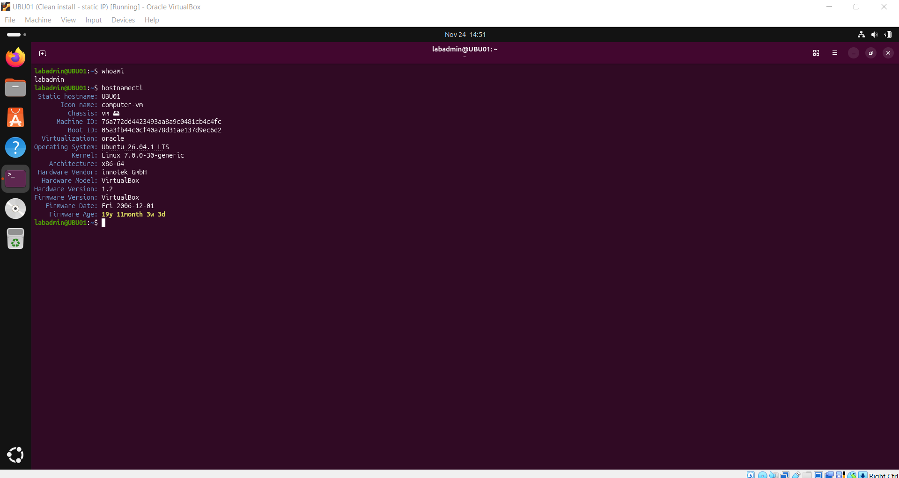
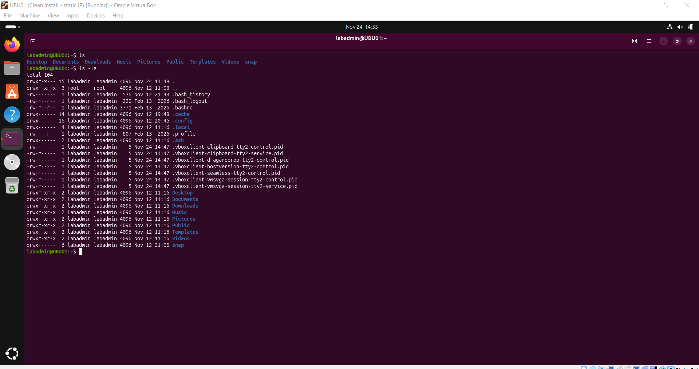
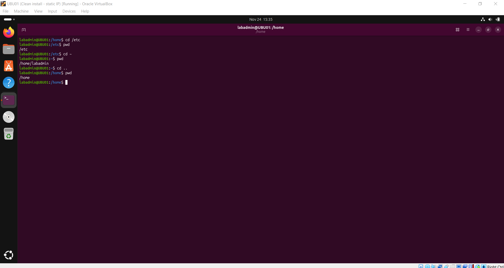
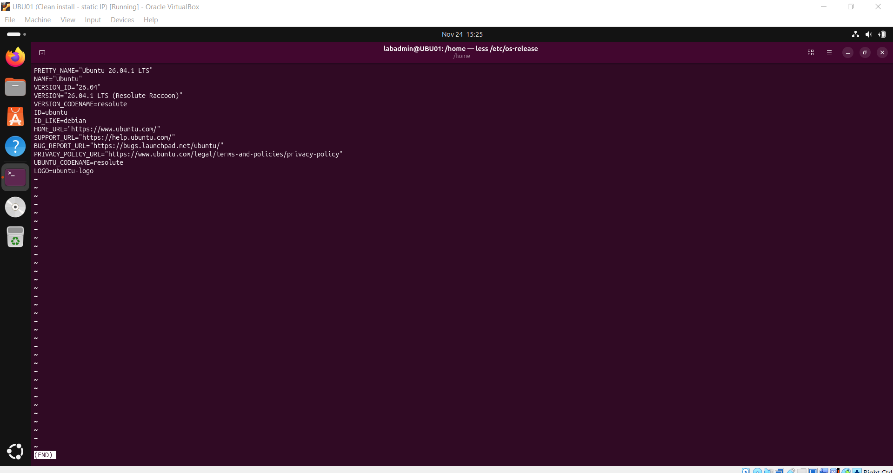
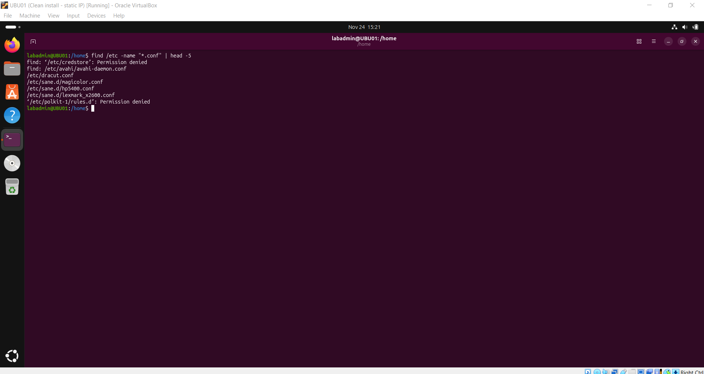
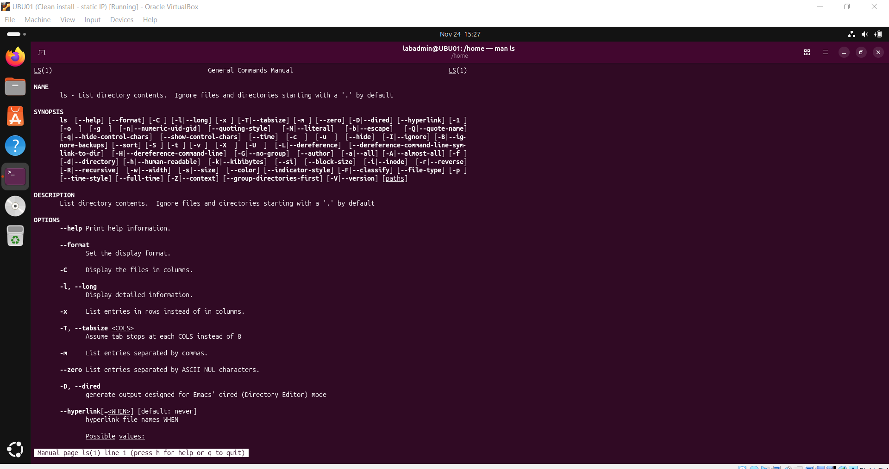

# Navigating the Linux Filesystem

## Objective

I wanted to learn how to find my way around Ubuntu from the terminal. Help desk work often means logging into a Linux server or workstation, and I need to know where I am, what's in a folder, and how to read a file without a mouse. I also learned that `man` pages and `find` are the fastest ways to answer "where is this setting?"

## Environment

- VM: UBU01, Ubuntu 26.04.1 LTS (Resolute Raccoon), running in VirtualBox on labnet
- User: `labadmin`, home folder `/home/labadmin`
- Tools: the GNOME terminal, plus `whoami`, `hostnamectl`, `ls`, `cat`, `less`, `find`, and `man`

## Steps

**Part 1: Confirm who I am and which machine I'm on.** I opened the terminal and ran `whoami`, which showed `labadmin`. Then I ran `hostnamectl`, which showed the static hostname `UBU01`, the OS, the kernel, and that the machine is a VirtualBox VM.



**Part 2: List the home folder, including hidden files.** `ls` showed the normal folders: Desktop, Documents, Downloads, Music, Pictures, Public, Templates, Videos, and snap. `ls -la` showed more. The extra entries start with a dot, like `.bashrc`, `.config`, and `.ssh`, so they're hidden from a plain `ls`. The long format also shows the permissions. For example, `.ssh` shows `drwx------`, which means only my user can read it.



**Part 3: Move between folders and read a text file.** I used `cd` to move around and `pwd` to check where I was after each move. `cd /etc` took me to `/etc`, `cd ~` took me back to my home folder `/home/labadmin`, and `cd ..` moved up one level to `/home`.



Then I ran `less /etc/os-release`, which showed the Ubuntu version fields, including `VERSION="26.04.1 LTS (Resolute Raccoon)"`. `less` lets me scroll through a file one screen at a time. I pressed `q` to quit it.



**Part 4: Search for config files with `find`.** I ran:

```
find /etc -name "*.conf" | head -5
```

It printed matching paths such as `/etc/dracut.conf` and the files in `/etc/sane.d/`. It also printed several `Permission denied` lines for folders my user can't read, like `/etc/credstore` and `/etc/polkit-1/rules.d`. `head -5` limits the matches shown, but it doesn't limit the error messages.



**Part 5: Read a manual page.** I ran `man ls`. The page has sections like NAME, SYNOPSIS, DESCRIPTION, and OPTIONS. I scrolled with the arrow keys, which showed options like `-l` for the long format and `-a` for hidden files, and pressed `q` to quit.



## Troubleshooting

| Problem | What caused it | How I fixed it |
|---------|----------------|----------------|
| `find` printed "Permission denied" for some folders | Those folders belong to root, and my user can't read them | This is expected. To hide the errors, add `2>/dev/null` to the end of the `find` command |
| `ls` didn't show a file I knew was there | The file's name starts with a dot, so `ls` hides it | I used `ls -la` to show hidden files |

## What I learned

- `whoami` and `hostnamectl` tell me which user and machine I'm on, which matters before I change anything.
- `ls -la` shows hidden files and permissions, and the permissions are the first thing to check when access fails.
- `less` is the safe way to read a long file. `cat` dumps the whole file at once.
- `find` searches by name, and `man` pages list every option for a command. I can use both when I don't remember a command's syntax.